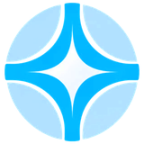
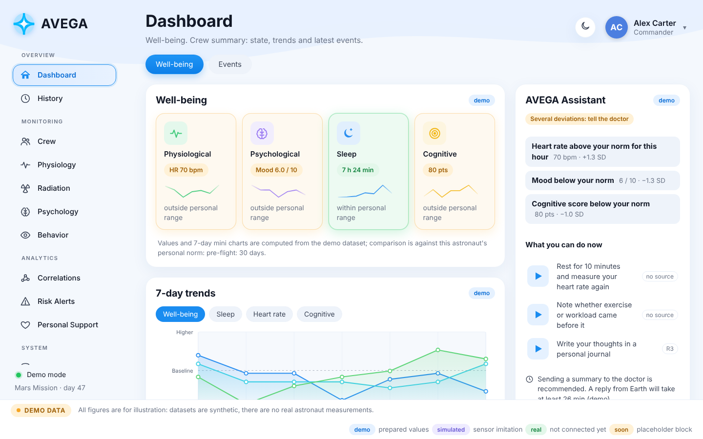
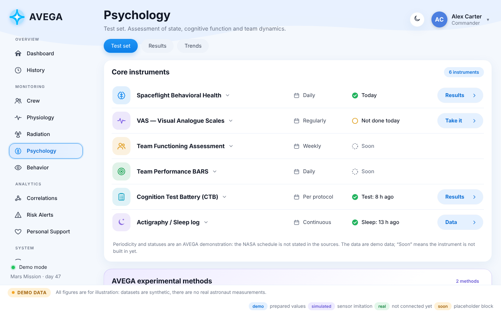
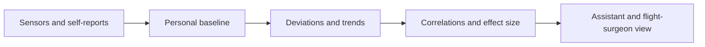
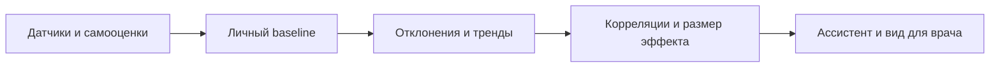

<a id="english"></a>

<div align="center">



# AVEGA

**Integrated Astronaut Health &amp; Crew Well-being Monitoring System**

Finding the links between mind and body on long space missions.


**[▶ Live demo](https://maestoo-of-69.github.io/avega/)** · [Screenshots](#screenshots) · [Русский](#russian)

</div>



## Why AVEGA

Long missions, such as a future flight to Mars, put a crew far from help for a long time. Psychological and physiological states influence each other, so AVEGA keeps them in one place instead of in separate tools. Every astronaut is compared with their own baseline rather than a population range. The aim is to notice early signals and offer support that carries a source, not to replace the flight surgeon.

## Key features

<table>
<tr>
<td valign="top">🎯 <b>Personal baselines</b><br>Each person is compared with their own pre-flight norm, not a population range.</td>
<td valign="top">🔗 <b>Mind ↔ body links</b><br>Same-day and next-day correlations between physiology and psychology, with effect sizes in plain words.</td>
</tr>
<tr>
<td valign="top">🗓️ <b>Weekly AI-free assistant</b><br>Rules and statistics: weekly trend summary, recommendations with source IDs, and a data-aware interview.</td>
<td valign="top">🧠 <b>NASA-based instruments</b><br>Psychological and cognitive instrument catalogue on the Psychology page; the VAS self-rating works.</td>
</tr>
<tr>
<td valign="top">☢️ <b>Radiation monitoring</b><br>Simulated dose-rate stream and cumulative dose, modelled on NASA's Crew Active Dosimeter.</td>
<td valign="top">🩺 <b>Flight-surgeon view</b><br>The Earth-side doctor sees each crew member's values as of now minus the Earth–Mars communication delay.</td>
</tr>
<tr>
<td valign="top">✍️ <b>Authored methods</b><br>Creative Task and Crew Connection are AVEGA's own methods, not NASA instruments.</td>
<td valign="top">📴 <b>Offline, bilingual, light/dark</b><br>One HTML file with data and images; Russian and English; light and dark themes.</td>
</tr>
</table>

## Screenshots

<table>
<tr>
<td align="center" width="33%"><br><sub>Dashboard</sub></td>
<td align="center" width="33%"><br><sub>Psychology: instrument set</sub></td>
<td align="center" width="33%"><br><sub>Radiation exposure</sub></td>
</tr>
<tr>
<td align="center" width="33%"><br><sub>Correlation matrix</sub></td>
<td align="center" width="33%"><br><sub>Assistant: weekly summary</sub></td>
<td align="center" width="33%"><br><sub>Crew Connection</sub></td>
</tr>
</table>

## How it works



## Quick start

- **Live demo:** https://maestoo-of-69.github.io/avega/
- **Local:** open `index.html` in a browser; no server or network is needed.
- **Rebuild** after changing `prototype/` or `data/`: `python3 prototype/build_shell.py`
- **Tests:** `pip install playwright`, then `bash tests/run_all.sh`

## AVEGA Assistant — help when the doctor is far away

On a Mars mission a question to the flight surgeon takes up to 22 minutes each way (C1, C2). The AVEGA Assistant works **offline, on board**, so a crew member gets structured help immediately, before the doctor's answer arrives.

**What it does**
- **Interview.** Asks one plain question at a time (what bothers you, how strong, since when, warning signs) and checks the answers against the person's own data — e.g. «you said "today", but stress has been above your usual level for 6 days».
- **Weekly review.** Shows which indicators are outside the personal norm and since which day, and how they are linked in this person's data, with effect sizes.
- **Recommendations.** Gives safe first steps (sleep routine, light, slow breathing, journaling, contact with family) — each with its source ID, or marked "no source".
- **Urgency level.** Sorts the situation into «watch», «tell the doctor» or «urgent» by simple rules taken from the handbook; red-flag words (chest pain, fainting, vision changes, confusion, breathing difficulty, self-harm thoughts) always lead to «urgent».
- **Summary for the doctor.** Prepares a short plain-text summary that can be sent to Earth in one tap.

**What it does not do:** no diagnosis, no medication or doses, no language model — every answer is built from rules, the person's statistics and the handbook below.

**Handbook: 17 space-health topics and their sources**

| Topic | Sources |
|---|---|
| Space motion sickness | R8, S2, S3 |
| Back pain during adaptation | S1 |
| Headache and cabin CO₂ | S4 |
| Neuro-ocular syndrome (SANS) | R9 |
| Immunity and virus reactivation | R10, S5, S6 |
| Sleep loss and schedule shifts | R6, P1, P2 |
| Psychological state | R3, N6 |
| Heart, vessels and landing | R5 |
| Bones and muscles | R4, R7 |
| Radiation | R2 |
| Decompression sickness | R11 |
| Mild hypoxia | R12 |
| Nutrition | R13 |
| Infections and microorganisms | R14 |
| Spacewalk injuries | R15 |
| Crew relationships | R16 |
| Landing and g-loads | R17 |

Recommendation sources: sleep — P2, R6; stress and mood — P4, R3; energy — P1, R7; cognition — P3. Method: [docs/CHAT_SPEC_V3.md](docs/CHAT_SPEC_V3.md).

## Scientific basis

> Key NASA sources for what can be measured on astronauts and how: **N7** Spaceflight Standard Measures (npj Microgravity 2025), **N8** Astroskin wearable biosensor monitor, **N9** NASA Human Research Program, **R1** HRP risk list.

Every outside fact in AVEGA is recorded with its source; the full list with what each source says and does not say is in [docs/REFERENCES.md](docs/REFERENCES.md).

### NASA instruments on the Psychology page

| Instrument | Role in AVEGA | Source | In the prototype |
|---|---|---|---|
| Behavioral-health check-in (daily) | main regular source of psychological-state information, tracked against the individual baseline | NASA HRP — [Risk of behavioral conditions](https://www.nasa.gov/reference/risk-of-behavioral-conditions-and-psychiatric-disorders/) | daily mood / stress / energy check-in |
| VAS — Visual Analogue Scales | short regular self-rating, e.g. stress on a 0–100 scale | NASA Human Research Roadmap, [task 1623](https://humanresearchroadmap.nasa.gov/Tasks/task.aspx?i=1623) | working: 7 scales |
| Team Functioning Assessment | weekly crew-state assessment shown as team trends, without exposing individual answers | NASA HRP — [Risk of inadequate teamwork](https://www.nasa.gov/reference/risk-of-inadequate-teamwork/) | planned |
| Team Performance BARS | dynamics of teamwork ratings, detection of sustained decline | [NASA NTRS 20210023420](https://ntrs.nasa.gov/citations/20210023420) | planned |
| NASA Cognition Test Battery (CTB) | cognitive performance vs. the person's own baseline | Basner et al., [PMC4691281](https://pmc.ncbi.nlm.nih.gov/articles/PMC4691281/); [Cognition test battery, UPenn](https://www.med.upenn.edu/uep/cognition.html) | demo composite score |
| Actigraphy / Sleep log | objective activity + subjective sleep compared with psychological indicators | [NASA Spaceflight Standard Measures](https://www.nasa.gov/reference/standard-measures/) | sleep duration |
| Creative Task · Crew Connection | AVEGA's own methods (not NASA instruments) | — | working |

### Sources by topic

**NASA HRP risks (R1–R17)**

- **R1** — [HRP risk list](https://www.nasa.gov/hrp/risks/) — used for choosing which health domains AVEGA covers
- **R2** — [Risk of radiation-induced cancers](https://www.nasa.gov/reference/risk-of-radiation-induced-cancers/) — used for radiation module; no invented dose limits
- **R3** — [Risk of behavioral conditions and psychiatric disorders](https://www.nasa.gov/reference/risk-of-behavioral-conditions-and-psychiatric-disorders/) — used for check-in design, support suggestions, delay modelling
- **R4** — [Risk of spaceflight-induced bone changes](https://www.nasa.gov/reference/risk-of-spaceflight-induced-bone-changes/) — used for bone as a pre/post-flight measure, no live stream
- **R5** — [Risk of cardiovascular adaptations](https://www.nasa.gov/reference/risk-of-cardiovascular-adaptations/) — used for heart-rate stream labelled simulated
- **R6** — [Risk from inadequate sleep and irregular schedules](https://www.nasa.gov/reference/risk-from-inadequate-sleep-and-irregular-schedules/) — used for sleep-duration tracking
- **R7** — [Risk of reduced cardiorespiratory and musculoskeletal fitness](https://www.nasa.gov/reference/risk-of-reduced-cardiorespiratory-and-musculoskeletal-fitness/) — used for activity and exercise placeholders
- **R8** — [Risk of altered sensorimotor and vestibular function](https://www.nasa.gov/reference/risk-of-altered-sensorimotor-and-vestibular-function/) — used for handbook entry: motion sickness
- **R9** — [Risk of SANS](https://www.nasa.gov/reference/risk-of-spaceflight-associated-neuro-ocular-syndrome-sans/) — used for handbook entry: vision changes
- **R10** — [Risk of altered immune system responses](https://www.nasa.gov/reference/risk-of-altered-immune-system-responses/) — used for handbook entry: immune and skin symptoms
- **R11** — [Risk of decompression sickness](https://www.nasa.gov/reference/risk-of-decompression-sickness/) — used for handbook entry: decompression sickness
- **R12** — [Risk of hypoxia](https://www.nasa.gov/reference/risk-of-hypoxia/) — used for handbook entry: hypoxia
- **R13** — [Risk of inadequate food and nutrition](https://www.nasa.gov/reference/risk-of-inadequate-food-and-nutrition/) — used for handbook entry: food and nutrition
- **R14** — [Risk of host–microorganism interactions](https://www.nasa.gov/reference/risk-of-host-microorganism-interactions/) — used for handbook entry: microbiome
- **R15** — [Risk of injury and compromised performance from spacewalks (EVA)](https://www.nasa.gov/reference/risk-of-injury-and-compromised-performance-from-extravehicular-activity-eva/) — used for handbook entry: spacewalk (EVA) risks
- **R16** — [Risk of inadequate teamwork](https://www.nasa.gov/reference/risk-of-inadequate-teamwork/) — used for handbook entry; context for Crew Connection
- **R17** — [Risk of injury from dynamic loads](https://www.nasa.gov/reference/risk-of-injury-from-dynamic-loads/) — used for handbook entry: dynamic loads

**Standard measures and other agencies (N1–N6, J1, J2, K1, K2)**

- **N1** — [NASA Spaceflight Standard Measures (overview)](https://www.nasa.gov/humans-in-space/spaceflight-standard-measures-characterizing-how-humans-adapt-in-space) — used for choosing AVEGA's parameter families
- **N2** — [NASA NTRS 20200001281, Standard Measures slides](https://ntrs.nasa.gov/api/citations/20200001281/downloads/20200001281.pdf) — used for check-in content and frequency ideas; pre-flight baseline
- **N3** — [NASA NTRS 20190000670, BHP Standard Measures overview](https://ntrs.nasa.gov/citations/20190000670) — used for combining physiological and self-report streams
- **N4** — [NASA NTRS 20170005421, BHP Laboratory Standard Measures](https://ntrs.nasa.gov/citations/20170005421) — used for planned parameters: pre-flight personality, sleep log
- **N5** — [NASA NTRS 20220013722, Isolation Standard Measures](https://ntrs.nasa.gov/citations/20220013722) — used for domain list in docs/PARAMETERS.md
- **N6** — [NASA NTRS 20260002661, behavioural health and team metrics in isolation](https://ntrs.nasa.gov/citations/20260002661) — used for why each person is compared with their own norm
- **N7** — [Spaceflight Standard Measures, npj Microgravity 2025](https://pmc.ncbi.nlm.nih.gov/articles/PMC12612093/) — used for parameter families and how often each is measured
- **N8** — [Astroskin wearable biosensor monitor, NTRS 20190000238](https://ntrs.nasa.gov/citations/20190000238) — used for which wearable streams a real AVEGA could read
- **N9** — [NASA Human Research Program](https://www.nasa.gov/hrp/) — used for programme context of the HRP risks
- **J1** — [JAXA confined-facility study, Sci Rep 2018 (PMC5974367)](https://pmc.ncbi.nlm.nih.gov/articles/PMC5974367) — used for planned parameter: cortisol rhythm (no such data yet)
- **J2** — [JAXA isolation test for long ISS stays](https://iss.jaxa.jp/iss/kibo/develop_status_12_e.html) — used for support functions: contact with family and doctor
- **K1** — [Canadian Space Agency health experiments, Expedition 58](https://www.asc-csa.gc.ca/eng/missions/expedition58/about-the-mission/health-science-experiments.asp) — used for sensors a real AVEGA could read: wearable vitals, dosimetry
- **K2** — [Government of Canada backgrounder, At Home in Space](https://www.canada.ca/en/space-agency/news/2017/11/international_spacestationissongoingcanadianhealthexperimentsand.html) — used for planned team-climate block

**Radiation (R22–R28)**

- **R22** — [NASA SRAG: Crew Active Dosimeter](https://srag.jsc.nasa.gov/SpaceRadiation/How/How.cfm) — used for device card and record format
- **R23** — George et al., Nature 2024, Artemis I ([OSTI](https://www.osti.gov/pages/servlets/purl/2447574); [NASA summary](https://www.nasa.gov/humans-in-space/artemis-i-radiation-measurements-validate-orion-safety-for-astronauts/)) — used for why per-person dose differs; shielding factors are demo values
- **R25** — Zeitlin et al., Science 2013, RAD in transit to Mars ([SwRI release](https://www.swri.org/newsroom/press-releases/swri-led-team-calculates-the-radiation-exposure-associated-trip-mars); [A&A 2015](https://www.aanda.org/10.1051/0004-6361/201525680)) — used for simulated base dose rate and coarse Sv estimate factor
- **R26** — [NASA-STD-3001 technical brief OCHMO-TB-020](https://www.nasa.gov/wp-content/uploads/2023/03/radiation-protection-technical-brief-ochmo.pdf) — used for limit bar, compared with an estimate and labelled as such
- **R27** — [Feiveson et al., Sci Rep 2021, chromosome damage](https://doaj.org/article/bade7148abc2402f9e8c4d6c3b98ddad) — used for dose ↔ chromosome aberrations row (lab test, not simulated)
- **R28** — [NASA Ames Radiation Biophysics Lab](https://www.nasa.gov/ames/research/space-biosciences/radiation-biophysics) — used for research-stage rows in the physiology-link tab

**Peer-reviewed evidence (P1–P6, S1–S6)**

- **P1** — [Barger et al., Lancet Neurology 2014 (press release)](https://www.eurekalert.org/news-releases/541449) — used for sleep as a priority signal; assistant never suggests medication
- **P2** — [Basner et al., PNAS 2013, Mars 520-day simulation](https://www.med.upenn.edu/uep/assets/user-content/documents/PNAS2013Basner1212646110withSupportingAppendix.pdf) — used for advice on regular sleep–wake timing and light
- **P3** — [Cognition test battery, University of Pennsylvania](https://www.med.upenn.edu/uep/cognition.html) — used for design target for AVEGA's cognitive tests
- **P4** — Goessl, Curtiss & Hofmann, Psychological Medicine 2017 — used for basis of the slow-breathing suggestion
- **P5** — [Kim et al., Psychiatry Investigation 2018, stress and HRV](https://pubmed.ncbi.nlm.nih.gov/29486547/) — used for HRV as a planned parameter
- **P6** — [PMC4691281, cognition test battery publication](https://pmc.ncbi.nlm.nih.gov/articles/PMC4691281/) — used for supports the CTB item
- **S1** — [Kerstman et al., 2012, space adaptation back pain](https://ntrs.nasa.gov/citations/20090019566) — used for handbook entry: back pain; non-drug options only
- **S2** — [Khalid et al., Front Neural Circuits 2023, space motion sickness](https://www.frontiersin.org/articles/10.3389/fncir.2023.1150233/full) — used for symptom list; no drug advice
- **S3** — [NASA NTRS 19830021722, space motion sickness report](https://ntrs.nasa.gov/api/citations/19830021722/downloads/19830021722.pdf) — used for typical duration wording: first 2–5 days
- **S4** — [Law et al., J Occup Environ Med 2014, CO₂ and headaches (summary)](https://www.ishn.com/articles/98606-occupational-hazard-in-space-headaches) — used for simulated cabin-CO₂ stream; CO₂–headache direction
- **S5** — [Rooney et al., Front Microbiol 2019, herpes virus reactivation](https://www.frontiersin.org/journals/microbiology/articles/10.3389/fmicb.2019.00016/full) — used for stress → skin-symptom link (direction only); immune entry
- **S6** — [Mehta et al., npj Microgravity 2017, latent virus reactivation](https://doaj.org/article/f32947e92776479e9e3b840364e87d36) — used for supporting source for the immune entry

**Communication delay (C1, C2)**

- **C1** — [NASA Science: Perseverance communications](https://science.nasa.gov/?p=354728) — used for demo one-way delay of 13 minutes
- **C2** — [NASA NTRS 20220013418, communication delays for crewed Mars missions](https://ntrs.nasa.gov/citations/20220013418) — used for why the doctor sees data as of an earlier moment

## Method in brief

- **Baseline:** mean and standard deviation of a person's own pre-flight days (30 days in the demo).
- **Deviations:** a value more than 1 SD from the personal norm in the unfavourable direction is a finding; 2 SD or more is strong.
- **Correlation:** Pearson r between daily means, same day and lag-1 (X today, Y tomorrow).
- **Effect-size rule:** a link is called noticeable when both groups have at least 5 days, |r| ≥ 0.3, and the difference is at least 0.3 SD.
- **7-day trend:** the assistant compares the last 7 days with the person's earlier days.

Correlation is not causation; thresholds are demonstration values. Details: [docs/SCIENTIFIC_METHODOLOGY.md](docs/SCIENTIFIC_METHODOLOGY.md).

## Data & responsibility

- **All data are synthetic.** They come from the generator in `data/`; the repository contains no real astronaut or patient data.
- **No AI model inside the app.** The assistant and chat use rules and statistics.
- **No diagnosis and no medication advice.** Thresholds are demonstration values, not clinical limits.

## Repository structure

```
index.html     built single-file app (GitHub Pages entry)
prototype/     app sources, build script, icons, images
data/          synthetic data generator and per-person JSON
docs/          methodology, references, parameters, roadmap, screenshots
tests/         Playwright test suites
LICENSE        MIT
```

## Roadmap

- Link chat-reported symptoms and interview answers to psychological indicators over time
- A short weekly creative game that yields psychological indicators, based on published instruments
- Validated mood and anxiety scales, taken from the full papers
- HRV (needs beat-to-beat intervals from a sensor)
- Radiation dose from a real dosimeter source
- Prevention suggestions from a person's own lead–lag links, once real data exist
- Team Functioning Assessment and Team Performance BARS
- Team images for the Creative Task and Crew Connection scenarios

## Team · AI disclosure · License

AVEGA team (Kuka's Crew) · NASA Space Apps Challenge 2026

Team: [Maestoo-of-69](https://github.com/Maestoo-of-69) · [Vnvllcw](https://github.com/Vnvllcw) 

AI assistants were used to help write code and documentation under the team's direction; the app itself contains no AI model.

License: MIT, see `LICENSE`. Image credit: Ring Nebula — NASA, ESA, CSA, STScI.

---

<a id="russian"></a>

<div align="center">


# AVEGA

**Integrated Astronaut Health &amp; Crew Well-being Monitoring System**

Поиск связей между психикой и телом в длительных космических миссиях.


**[▶ Живая демо-версия](https://maestoo-of-69.github.io/avega/)** · [Скриншоты](#скриншоты) · [English](#english)

</div>


## Зачем AVEGA

Длительные миссии, например будущий полёт на Марс, надолго отдаляют экипаж от помощи. Психологическое и физиологическое состояния влияют друг на друга, поэтому AVEGA держит их в одном месте, а не в разных инструментах. Каждый астронавт сравнивается с собственным baseline, а не с популяционным диапазоном. Цель — заметить ранние сигналы и предложить поддержку с указанием источника, а не заменить бортового врача.

## Ключевые возможности

<table>
<tr>
<td valign="top">🎯 <b>Личные baseline</b><br>Каждый человек сравнивается с собственной предполётной нормой, а не с популяционным диапазоном.</td>
<td valign="top">🔗 <b>Связи психики и тела</b><br>Корреляции в тот же день и со сдвигом в один день между физиологией и психикой, с размерами эффекта простыми словами.</td>
</tr>
<tr>
<td valign="top">🗓️ <b>Еженедельный ассистент без ИИ</b><br>Правила и статистика: недельная сводка трендов, рекомендации с ID источников и интервью с учётом данных человека.</td>
<td valign="top">🧠 <b>Инструменты на основе NASA</b><br>Каталог психологических и когнитивных инструментов на странице Psychology; самооценка VAS работает.</td>
</tr>
<tr>
<td valign="top">☢️ <b>Мониторинг радиации</b><br>Смоделированный поток мощности дозы и накопленная доза по образцу NASA Crew Active Dosimeter.</td>
<td valign="top">🩺 <b>Вид для бортового врача</b><br>Врач на Земле видит значения каждого члена экипажа на момент «сейчас минус задержка связи Земля–Марс».</td>
</tr>
<tr>
<td valign="top">✍️ <b>Авторские методики</b><br>Creative Task и Crew Connection — собственные методики AVEGA, не инструменты NASA.</td>
<td valign="top">📴 <b>Офлайн, два языка, светлая и тёмная темы</b><br>Один HTML-файл с данными и изображениями; русский и английский; светлая и тёмная темы.</td>
</tr>
</table>

## Скриншоты

<table>
<tr>
<td align="center" width="33%"><br><sub>Дашборд</sub></td>
<td align="center" width="33%"><br><sub>Psychology: набор инструментов</sub></td>
<td align="center" width="33%"><br><sub>Радиация</sub></td>
</tr>
<tr>
<td align="center" width="33%"><br><sub>Матрица корреляций</sub></td>
<td align="center" width="33%"><br><sub>Ассистент: итоги недели</sub></td>
<td align="center" width="33%"><br><sub>Crew Connection</sub></td>
</tr>
</table>

## Как это работает



## Быстрый старт

- **Живая демо-версия:** https://maestoo-of-69.github.io/avega/
- **Локально:** откройте `index.html` в браузере; сервер и сеть не нужны.
- **Пересборка** после изменений в `prototype/` или `data/`: `python3 prototype/build_shell.py`
- **Тесты:** `pip install playwright`, затем `bash tests/run_all.sh`

## Ассистент AVEGA — помощь, когда врач далеко

В миссии на Марс вопрос врачу идёт до 22 минут в одну сторону (C1, C2). Ассистент AVEGA работает **офлайн, на борту**, поэтому член экипажа получает понятную помощь сразу, ещё до ответа врача.

**Что он умеет**
- **Опрос.** Задаёт по одному простому вопросу (что беспокоит, насколько сильно, с какого времени, тревожные признаки) и сверяет ответы с личными данными человека — например: «вы ответили „сегодня“, а по данным стресс хуже обычного уже 6 дней».
- **Обзор недели.** Показывает, какие показатели вышли за личную норму и с какого дня, и как они связаны именно у этого человека, с величиной эффекта.
- **Рекомендации.** Предлагает безопасные первые шаги (режим сна, свет, медленное дыхание, дневник, связь с близкими) — у каждого указан источник или пометка «без источника».
- **Уровень срочности.** По простым правилам из справочника относит ситуацию к «наблюдать», «сообщить врачу» или «срочно»; тревожные слова (боль в груди, обморок, нарушение зрения, спутанность, затруднённое дыхание, мысли о самоповреждении) всегда ведут к «срочно».
- **Сводка для врача.** Готовит короткую текстовую сводку, которую можно отправить на Землю одной кнопкой.

**Чего он не делает:** не ставит диагнозов, не советует лекарства и дозы, не использует языковую модель — каждый ответ строится из правил, личной статистики и справочника ниже.

**Справочник: 17 тем о здоровье в космосе и их источники**

| Тема | Источники |
|---|---|
| Космическая болезнь движения | R8, S2, S3 |
| Боль в спине при адаптации | S1 |
| Головная боль и CO₂ в кабине | S4 |
| Нейроокулярный синдром (SANS) | R9 |
| Иммунитет и реактивация вирусов | R10, S5, S6 |
| Недосып и сбой режима | R6, P1, P2 |
| Психологическое состояние | R3, N6 |
| Сердце, сосуды и посадка | R5 |
| Кости и мышцы | R4, R7 |
| Радиация | R2 |
| Декомпрессионная болезнь | R11 |
| Лёгкая гипоксия | R12 |
| Питание | R13 |
| Инфекции и микроорганизмы | R14 |
| Травмы при выходе в открытый космос | R15 |
| Отношения в экипаже | R16 |
| Посадка и перегрузки | R17 |

Источники рекомендаций: сон — P2, R6; стресс и настроение — P4, R3; энергия — P1, R7; когнитивные функции — P3. Метод: [docs/CHAT_SPEC_V3.md](docs/CHAT_SPEC_V3.md).

## Научная основа

> Ключевые источники NASA о том, что и как измеряют у астронавтов: **N7** Spaceflight Standard Measures (npj Microgravity 2025), **N8** носимый монитор Astroskin, **N9** NASA Human Research Program, **R1** список рисков HRP.

Каждый внешний факт в AVEGA записан вместе с источником; полный список с тем, что источник говорит и чего не говорит, находится в [docs/REFERENCES.md](docs/REFERENCES.md).

### Инструменты NASA на странице Psychology

| Instrument | Роль в AVEGA | Источник | В прототипе |
|---|---|---|---|
| Behavioral-health check-in (daily) | основной источник регулярной информации о психологическом состоянии относительно индивидуального baseline | NASA HRP — [Risk of behavioral conditions](https://www.nasa.gov/reference/risk-of-behavioral-conditions-and-psychiatric-disorders/) | ежедневный check-in: настроение / стресс / энергия |
| VAS — Visual Analogue Scales | короткая регулярная самооценка, например уровень стресса на шкале от 0 до 100 | NASA Human Research Roadmap, [task 1623](https://humanresearchroadmap.nasa.gov/Tasks/task.aspx?i=1623) | работает: 7 шкал |
| Team Functioning Assessment | еженедельная оценка состояния экипажа как командные тенденции, без раскрытия индивидуальных ответов | NASA HRP — [Risk of inadequate teamwork](https://www.nasa.gov/reference/risk-of-inadequate-teamwork/) | планируется |
| Team Performance BARS | динамика оценки командной работы и выявление устойчивого ухудшения взаимодействия | [NASA NTRS 20210023420](https://ntrs.nasa.gov/citations/20210023420) | планируется |
| NASA Cognition Test Battery (CTB) | когнитивная производительность относительно собственных исходных результатов | Basner et al., [PMC4691281](https://pmc.ncbi.nlm.nih.gov/articles/PMC4691281/); [Cognition test battery, UPenn](https://www.med.upenn.edu/uep/cognition.html) | демо-композитный балл |
| Actigraphy / Sleep log | объективная активность и субъективная оценка сна в сопоставлении с психологическими показателями | [NASA Spaceflight Standard Measures](https://www.nasa.gov/reference/standard-measures/) | длительность сна |
| Creative Task · Crew Connection | собственные методики AVEGA (не инструменты NASA) | — | работает |

### Источники по темам

**Риски NASA HRP (R1–R17)**

- **R1** — [HRP risk list](https://www.nasa.gov/hrp/risks/) — применение: выбор охватываемых доменов здоровья
- **R2** — [Risk of radiation-induced cancers](https://www.nasa.gov/reference/risk-of-radiation-induced-cancers/) — применение: модуль радиации; без выдуманных пределов доз
- **R3** — [Risk of behavioral conditions and psychiatric disorders](https://www.nasa.gov/reference/risk-of-behavioral-conditions-and-psychiatric-disorders/) — применение: дизайн check-in, рекомендации поддержки, модель задержки
- **R4** — [Risk of spaceflight-induced bone changes](https://www.nasa.gov/reference/risk-of-spaceflight-induced-bone-changes/) — применение: кости как измерение до и после полёта, без потока данных
- **R5** — [Risk of cardiovascular adaptations](https://www.nasa.gov/reference/risk-of-cardiovascular-adaptations/) — применение: поток пульса помечен как смоделированный
- **R6** — [Risk from inadequate sleep and irregular schedules](https://www.nasa.gov/reference/risk-from-inadequate-sleep-and-irregular-schedules/) — применение: учёт длительности сна
- **R7** — [Risk of reduced cardiorespiratory and musculoskeletal fitness](https://www.nasa.gov/reference/risk-of-reduced-cardiorespiratory-and-musculoskeletal-fitness/) — применение: заглушки активности и упражнений
- **R8** — [Risk of altered sensorimotor and vestibular function](https://www.nasa.gov/reference/risk-of-altered-sensorimotor-and-vestibular-function/) — применение: справочник: укачивание
- **R9** — [Risk of SANS](https://www.nasa.gov/reference/risk-of-spaceflight-associated-neuro-ocular-syndrome-sans/) — применение: справочник: изменения зрения
- **R10** — [Risk of altered immune system responses](https://www.nasa.gov/reference/risk-of-altered-immune-system-responses/) — применение: справочник: иммунные и кожные симптомы
- **R11** — [Risk of decompression sickness](https://www.nasa.gov/reference/risk-of-decompression-sickness/) — применение: справочник: декомпрессионная болезнь
- **R12** — [Risk of hypoxia](https://www.nasa.gov/reference/risk-of-hypoxia/) — применение: справочник: гипоксия
- **R13** — [Risk of inadequate food and nutrition](https://www.nasa.gov/reference/risk-of-inadequate-food-and-nutrition/) — применение: справочник: питание
- **R14** — [Risk of host–microorganism interactions](https://www.nasa.gov/reference/risk-of-host-microorganism-interactions/) — применение: справочник: микробиом
- **R15** — [Risk of injury and compromised performance from spacewalks (EVA)](https://www.nasa.gov/reference/risk-of-injury-and-compromised-performance-from-extravehicular-activity-eva/) — применение: справочник: риски выхода в открытый космос (EVA)
- **R16** — [Risk of inadequate teamwork](https://www.nasa.gov/reference/risk-of-inadequate-teamwork/) — применение: справочник; контекст для Crew Connection
- **R17** — [Risk of injury from dynamic loads](https://www.nasa.gov/reference/risk-of-injury-from-dynamic-loads/) — применение: справочник: динамические нагрузки

**Стандартные измерения и другие агентства (N1–N6, J1, J2, K1, K2)**

- **N1** — [NASA Spaceflight Standard Measures (overview)](https://www.nasa.gov/humans-in-space/spaceflight-standard-measures-characterizing-how-humans-adapt-in-space) — применение: выбор семейств параметров AVEGA
- **N2** — [NASA NTRS 20200001281, Standard Measures slides](https://ntrs.nasa.gov/api/citations/20200001281/downloads/20200001281.pdf) — применение: идеи содержания и частоты check-in; предполётный baseline
- **N3** — [NASA NTRS 20190000670, BHP Standard Measures overview](https://ntrs.nasa.gov/citations/20190000670) — применение: объединение физиологических потоков и самооценок
- **N4** — [NASA NTRS 20170005421, BHP Laboratory Standard Measures](https://ntrs.nasa.gov/citations/20170005421) — применение: планируемые параметры: личность до полёта, дневник сна
- **N5** — [NASA NTRS 20220013722, Isolation Standard Measures](https://ntrs.nasa.gov/citations/20220013722) — применение: список доменов в docs/PARAMETERS.md
- **N6** — [NASA NTRS 20260002661, behavioural health and team metrics in isolation](https://ntrs.nasa.gov/citations/20260002661) — применение: почему каждый человек сравнивается с собственной нормой
- **N7** — [Spaceflight Standard Measures, npj Microgravity 2025](https://pmc.ncbi.nlm.nih.gov/articles/PMC12612093/) — применение: семейства параметров и периодичность их измерения
- **N8** — [Astroskin wearable biosensor monitor, NTRS 20190000238](https://ntrs.nasa.gov/citations/20190000238) — применение: какие потоки носимого датчика могла бы читать реальная AVEGA
- **N9** — [NASA Human Research Program](https://www.nasa.gov/hrp/) — применение: общий контекст рисков HRP
- **J1** — [JAXA confined-facility study, Sci Rep 2018 (PMC5974367)](https://pmc.ncbi.nlm.nih.gov/articles/PMC5974367) — применение: планируемый параметр: ритм кортизола (данных пока нет)
- **J2** — [JAXA isolation test for long ISS stays](https://iss.jaxa.jp/iss/kibo/develop_status_12_e.html) — применение: функции поддержки: связь с семьёй и врачом
- **K1** — [Canadian Space Agency health experiments, Expedition 58](https://www.asc-csa.gc.ca/eng/missions/expedition58/about-the-mission/health-science-experiments.asp) — применение: датчики, которые мог бы читать реальный AVEGA: носимые, дозиметрия
- **K2** — [Government of Canada backgrounder, At Home in Space](https://www.canada.ca/en/space-agency/news/2017/11/international_spacestationissongoingcanadianhealthexperimentsand.html) — применение: планируемый блок командного климата

**Радиация (R22–R28)**

- **R22** — [NASA SRAG: Crew Active Dosimeter](https://srag.jsc.nasa.gov/SpaceRadiation/How/How.cfm) — применение: карточка устройства и формат записи
- **R23** — George et al., Nature 2024, Artemis I ([OSTI](https://www.osti.gov/pages/servlets/purl/2447574); [NASA summary](https://www.nasa.gov/humans-in-space/artemis-i-radiation-measurements-validate-orion-safety-for-astronauts/)) — применение: почему доза у людей различается; факторы экранирования — демо-значения
- **R25** — Zeitlin et al., Science 2013, RAD in transit to Mars ([SwRI release](https://www.swri.org/newsroom/press-releases/swri-led-team-calculates-the-radiation-exposure-associated-trip-mars); [A&A 2015](https://www.aanda.org/10.1051/0004-6361/201525680)) — применение: базовая смоделированная мощность дозы и грубый коэффициент для Зв
- **R26** — [NASA-STD-3001 technical brief OCHMO-TB-020](https://www.nasa.gov/wp-content/uploads/2023/03/radiation-protection-technical-brief-ochmo.pdf) — применение: шкала предела, сравнение с оценкой, с пометкой
- **R27** — [Feiveson et al., Sci Rep 2021, chromosome damage](https://doaj.org/article/bade7148abc2402f9e8c4d6c3b98ddad) — применение: строка «доза ↔ хромосомные аберрации» (лабораторный тест)
- **R28** — [NASA Ames Radiation Biophysics Lab](https://www.nasa.gov/ames/research/space-biosciences/radiation-biophysics) — применение: исследовательские строки во вкладке связей с физиологией

**Рецензируемые исследования (P1–P6, S1–S6)**

- **P1** — [Barger et al., Lancet Neurology 2014 (press release)](https://www.eurekalert.org/news-releases/541449) — применение: сон как приоритетный сигнал; ассистент не советует лекарства
- **P2** — [Basner et al., PNAS 2013, Mars 520-day simulation](https://www.med.upenn.edu/uep/assets/user-content/documents/PNAS2013Basner1212646110withSupportingAppendix.pdf) — применение: советы по режиму сна и свету
- **P3** — [Cognition test battery, University of Pennsylvania](https://www.med.upenn.edu/uep/cognition.html) — применение: ориентир для когнитивных тестов AVEGA
- **P4** — Goessl, Curtiss & Hofmann, Psychological Medicine 2017 — применение: основа рекомендации о медленном дыхании
- **P5** — [Kim et al., Psychiatry Investigation 2018, stress and HRV](https://pubmed.ncbi.nlm.nih.gov/29486547/) — применение: HRV как планируемый параметр
- **P6** — [PMC4691281, cognition test battery publication](https://pmc.ncbi.nlm.nih.gov/articles/PMC4691281/) — применение: основа пункта про CTB
- **S1** — [Kerstman et al., 2012, space adaptation back pain](https://ntrs.nasa.gov/citations/20090019566) — применение: справочник: боль в спине; только немедикаментозные способы
- **S2** — [Khalid et al., Front Neural Circuits 2023, space motion sickness](https://www.frontiersin.org/articles/10.3389/fncir.2023.1150233/full) — применение: список симптомов; без советов по лекарствам
- **S3** — [NASA NTRS 19830021722, space motion sickness report](https://ntrs.nasa.gov/api/citations/19830021722/downloads/19830021722.pdf) — применение: формулировка о длительности: первые 2–5 дней
- **S4** — [Law et al., J Occup Environ Med 2014, CO₂ and headaches (summary)](https://www.ishn.com/articles/98606-occupational-hazard-in-space-headaches) — применение: смоделированный поток CO₂; направление связи CO₂–головная боль
- **S5** — [Rooney et al., Front Microbiol 2019, herpes virus reactivation](https://www.frontiersin.org/journals/microbiology/articles/10.3389/fmicb.2019.00016/full) — применение: связь стресс → кожные симптомы (только направление); иммунная запись
- **S6** — [Mehta et al., npj Microgravity 2017, latent virus reactivation](https://doaj.org/article/f32947e92776479e9e3b840364e87d36) — применение: дополнительный источник для иммунной записи

**Задержка связи (C1, C2)**

- **C1** — [NASA Science: Perseverance communications](https://science.nasa.gov/?p=354728) — применение: демо-задержка 13 минут в одну сторону
- **C2** — [NASA NTRS 20220013418, communication delays for crewed Mars missions](https://ntrs.nasa.gov/citations/20220013418) — применение: почему врач видит данные на более ранний момент

## Метод кратко

- **Baseline:** среднее и стандартное отклонение собственных предполётных дней человека (в демо — 30 дней).
- **Отклонения:** значение дальше 1 SD от личной нормы в неблагоприятную сторону — находка; 2 SD и более — сильная.
- **Корреляция:** r Пирсона между дневными средними, в тот же день и со сдвигом 1 день (X сегодня, Y завтра).
- **Правило размера эффекта:** связь считается заметной, если в обеих группах не менее 5 дней, |r| ≥ 0,3, а разница не менее 0,3 SD.
- **Тренд за 7 дней:** ассистент сравнивает последние 7 дней с более ранними днями человека.

Корреляция не означает причинность; пороги — демонстрационные значения. Подробности: [docs/SCIENTIFIC_METHODOLOGY.md](docs/SCIENTIFIC_METHODOLOGY.md).

## Данные и ответственность

- **Все данные синтетические.** Они создаются генератором в `data/`; в репозитории нет реальных данных астронавтов или пациентов.
- **Внутри приложения нет модели ИИ.** Ассистент и чат работают на правилах и статистике.
- **Без диагнозов и советов по лекарствам.** Пороги — демонстрационные значения, а не клинические пределы.

## Структура репозитория

```
index.html     собранное одностраничное приложение (точка входа GitHub Pages)
prototype/     исходники приложения, скрипт сборки, значки, изображения
data/          генератор синтетических данных и JSON по людям
docs/          методология, источники, параметры, дорожная карта, скриншоты
tests/         наборы тестов Playwright
LICENSE        MIT
```

## Дорожная карта

- Связь симптомов и ответов интервью из чата с психологическими показателями во времени
- Короткая еженедельная творческая игра, дающая психологические показатели, на основе опубликованных инструментов
- Валидированные шкалы настроения и тревоги, взятые из полных статей
- HRV (нужны межударные интервалы от датчика)
- Доза радиации от реального источника дозиметра
- Предложения по профилактике на основе собственных связей «опережение–запаздывание», когда появятся реальные данные
- Team Functioning Assessment и Team Performance BARS
- Командные изображения для сценариев Creative Task и Crew Connection

## Команда · Использование ИИ · Лицензия

Команда AVEGA (Kuka's Crew) · NASA Space Apps Challenge 2026

Команда: [Maestoo-of-69](https://github.com/Maestoo-of-69) · [Vnvllcw](https://github.com/Vnvllcw)

ИИ-ассистенты использовались для помощи в написании кода и документации под руководством команды; само приложение не содержит модели ИИ.

Лицензия: MIT, см. `LICENSE`. Авторство изображения: туманность Кольцо — NASA, ESA, CSA, STScI.
