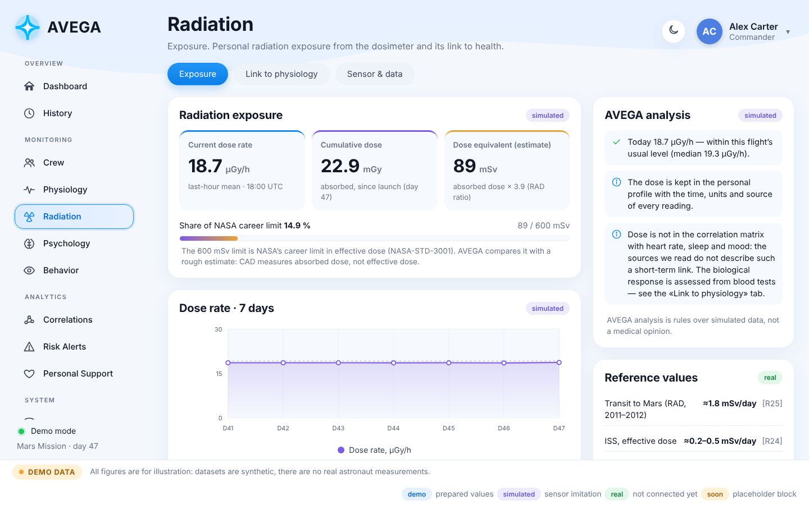
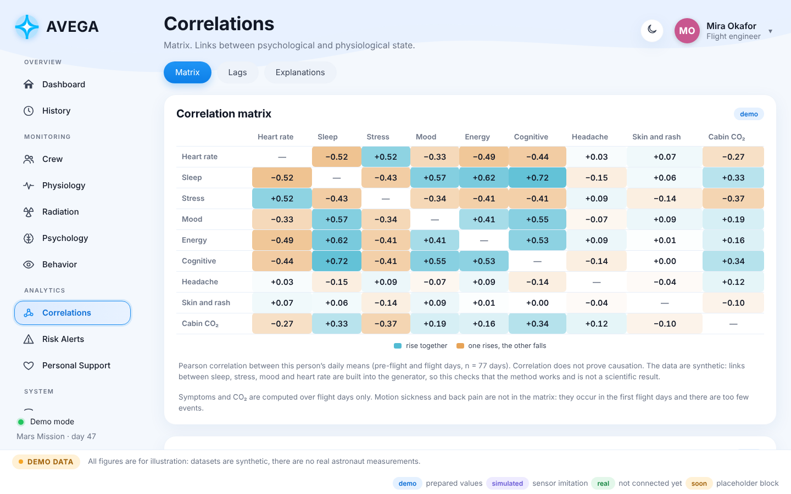
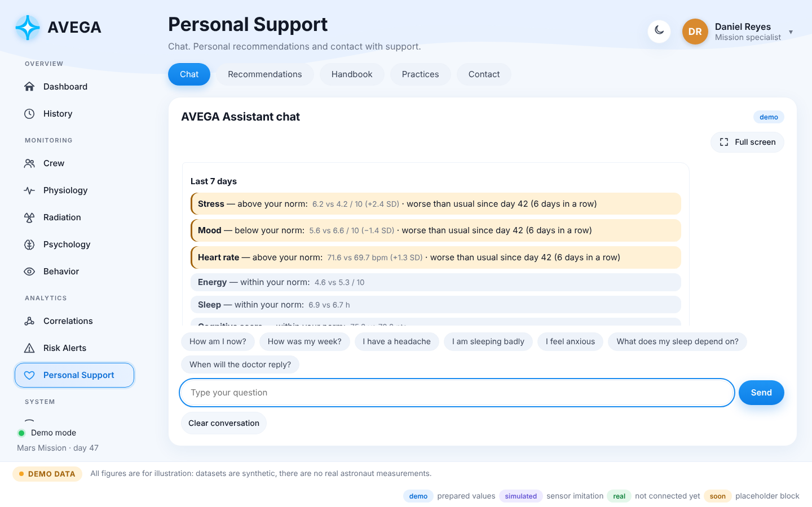
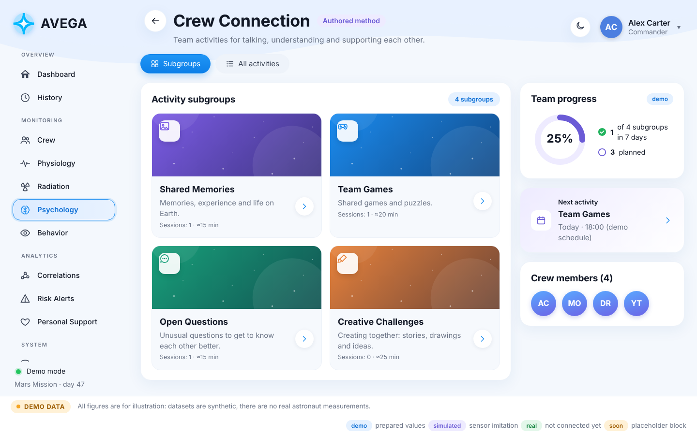

# AVEGA — Integrated Astronaut Health & Crew Well-being Monitoring System

**English** · [Русский](#russian)

<a id="english"></a>

AVEGA is a prototype of a monitoring tool for long space missions, such as a future crewed flight to Mars. It puts physiological signals, psychological self-ratings, cognitive scores and behavioural notes in one place and compares every person with their own baseline, so that the relationship between psychological and physiological state can be examined and early deviations noticed. It was made for the NASA Space Apps Challenge 2026. It runs as a single offline HTML file, and every number in it is synthetic.

Live demo: https://maestoo-of-69.github.io/avega/

Status: prototype with synthetic data

## What AVEGA does

- **Personal baselines.** Each person is compared with their own norm (mean and standard deviation of their own pre-flight period), not with a population range.
- **Psychology and physiology links.** Pearson correlations (same day and one-day lag) between heart rate, sleep, stress, mood, energy, cognitive score, symptoms and cabin CO₂, with effect sizes shown in plain words.
- **Weekly assistant.** Rule-based assistant with a weekly trend summary, recommendations that carry a source ID (or "no source"), a handbook of space-related conditions, and a data-aware interview that compares the user's answers with their own numbers.
- **NASA-based instrument set** on the Psychology page: a catalogue of behavioural-health instruments with their status in the prototype (see section 7.1), a working VAS self-rating, and two AVEGA-authored methods.
- **Radiation exposure monitoring**, modelled on the NASA Crew Active Dosimeter: simulated dose-rate stream, cumulative dose, a Sv estimate, comparison with the NASA career limit.
- **Flight-surgeon view** with communication delay: the Earth-side doctor sees each crew member's values as of "now minus delay".
- **Russian and English**, light and dark theme.
- **Offline single file**: the whole app, including data and images, is one `index.html`.

## Screenshots

| | |
|---|---|
| <br>Dashboard | <br>Psychology: instrument set |
| <br>Radiation exposure | <br>Correlation matrix |
| <br>Assistant: "How was my week?" | <br>Crew Connection |

## Data honesty

- **Every number is synthetic.** It is produced by the generator in `data/` (fixed seeds, deterministic). There is no real astronaut or patient data anywhere in the repository.
- **Labels in the interface:** `demo` (prepared values), `simulated` (imitation of a sensor stream), `real` (taken from a published source, for example reference values with a source ID), `soon` (placeholder, nothing computed).
- **No language model inside the app.** The assistant and the chat use rules and statistics: keyword matching, fixed texts from the on-board handbook, and the person's own numbers.
- **No diagnosis and no medication advice.** The app never names a drug or a dose; a medication question always gets the fixed line to follow the on-board protocol and the doctor.
- **Thresholds are demonstration values**, not clinical limits (the NASA radiation limits shown are quoted from the source and compared with an estimate, and labelled as such).
- **One labelled demo episode:** Daniel's stress is deliberately raised over the last 6 days so that the weekly summary has something to show. It is marked as invented; see `docs/SCIENTIFIC_METHODOLOGY.md`.

## Quick start

- **Use it:** open `index.html` in a browser. No server and no network are needed.
- **Rebuild it** after changing anything in `prototype/` or `data/`: `python3 prototype/build_shell.py` (Python 3.10+, standard library only). This writes `index.html` and `prototype/avega_shell.html` (the latter is git-ignored).
- **Run the tests:** `pip install playwright` and have Chrome installed, then `tests/run_all.sh` (see `tests/README.md`).

## Repository map

```
index.html          built single-file app (GitHub Pages entry), produced by prototype/build_shell.py
README.md           this file
LICENSE             MIT
.nojekyll           tells GitHub Pages to serve files as they are
prototype/          sources of the app, build script, icons, images
data/               synthetic data generator and per-person JSON
docs/               documentation and screenshots
tests/              Playwright test suites
```

**prototype/**

| File | Role |
|---|---|
| `build_shell.py` | Builds the single-file app: embeds CSS, JS, logos, icons, images and the per-person data |
| `shell.html`, `shell.css` | Page template and styles (light and dark theme) |
| `icons.html` | Icon set and avatar used by the build |
| `img/` | Images embedded into the app (see `img/README.md`) |
| `boot.js` | Accounts (one flight surgeon and four crew members) and safe localStorage helpers |
| `core.js` | Shared helpers, dataset, time constants and chart builders |
| `explorer.js` | History explorer (time scale, cursor, metric) |
| `i18n.js` | Russian / English: strings are written in both languages and applied after each render |
| `engine.js` | Correlations and the rule-based assistant: findings against the personal norm, weekly trend, link strength, recommendations with source IDs, the handbook |
| `chat.js` | Offline question-and-answer front end: retrieval and fixed templates only, red-flag and drug-question handling |
| `instruments.js` | Instrument catalogue on the Psychology page, VAS self-rating and its results |
| `radiation.js` | Simulated personal dosimeter stream modelled on the Crew Active Dosimeter |
| `creative.js` | AVEGA-authored methods: Creative Task and Crew Connection |
| `ui.js` | Application shell: pages, blocks, router, theme |

**data/**: `history_data.py` generates the synthetic history (heart rate, check-ins, cognitive scores, sleep, symptoms, cabin CO₂); `crew.py` defines the fictional crew and the demo communication delay; `crew_summary.py` builds the doctor-view summaries and exports `synthetic/*.json`; `demo_data.py` holds early placeholder values; `real/` is reserved for real data and is empty.

**docs/**: `SCIENTIFIC_METHODOLOGY.md`, `REFERENCES.md` (single source of truth for every outside fact), `PARAMETERS.md`, `DATA_SOURCES.md`, `AI_DISCLOSURE.md`, `ROADMAP.md`, and the chat specifications `CHAT_SPEC.md`, `CHAT_SPEC_V2.md`, `CHAT_SPEC_V3.md`.

## References — where every fact comes from and what it is used for

The list below is built from `docs/REFERENCES.md`, which holds the full notes, including what each source does **not** say. All entries were accessed on 2026-11-15. "What it says" is a paraphrase. Where a source was not opened, this is stated.

### 7.1 NASA behavioural-health instruments on the Psychology page

| Instrument | Role in AVEGA | Source | Source check | Status in prototype |
|---|---|---|---|---|
| Spaceflight Behavioral Health (team's label for the regular check-in) | Main regular source of psychological-state information; changes are tracked against the individual baseline | No document with this exact instrument name was found; context: NASA HRP risk of behavioral conditions ([R3](https://www.nasa.gov/reference/risk-of-behavioral-conditions-and-psychiatric-disorders/)) | Name not confirmed as a NASA instrument | Daily check-in on demo data |
| VAS — Visual Analogue Scales | Short regular self-rating, e.g. stress on a 0–100 scale | [R18](https://humanresearchroadmap.nasa.gov/Tasks/task.aspx?i=1623) | Page opened | Working: 7 scales, saved locally; item wording and anchors are AVEGA's own |
| Team Functioning Assessment | Weekly crew-state assessment; results shown as team trends without exposing individual answers to other crew members | [R21](https://pubmed.ncbi.nlm.nih.gov/31156490/) | NOT verified — page could not be opened (anti-bot check) | Planned, not built |
| Team Performance BARS (Behaviorally Anchored Rating Scale) | Show the dynamics of teamwork ratings and detect a sustained decline | [R20](https://ntrs.nasa.gov/citations/20210023420) | Abstract-level; source context is astronaut-applicant teamwork assessment, not in-flight monitoring | Planned, not built |
| NASA Cognition Test Battery (CTB) | Track changes in a person's cognitive performance against their own baseline | [P6](https://pmc.ncbi.nlm.nih.gov/articles/PMC4691281/) (opened), [P3](https://www.med.upenn.edu/uep/cognition.html), [P7](https://www.nature.com/articles/s41526-025-00532-6) (NOT verified — could not be opened) | Mixed, as stated | One demo composite score; the 10 tests are not implemented |
| Actigraphy / Sleep Log | Combine objective activity with subjective sleep ratings and compare them with psychological indicators | [R19](https://www.nasa.gov/reference/standard-measures/), N1, N2, N4 (see 7.3) | Opened | Sleep duration on demo data; actigraphy not simulated |
| Creative Task (AVEGA authored method, not a NASA instrument, not validated) | 5 abstract scenarios with private free-text answers | AVEGA's own method; context only: R3, R16 (see 7.2) | AVEGA authored method, not a NASA instrument, not validated | Working in the prototype; answers kept private |
| Crew Connection (AVEGA authored method, not a NASA instrument, not validated) | Shared crew activities; only the session date and participants are stored | AVEGA's own method; context only: R3, R16 (see 7.2) | AVEGA authored method, not a NASA instrument, not validated | Working in the prototype |

### 7.2 NASA Human Research Program risks (physiology and other risks)

| ID | Source | What it says | Used in AVEGA for |
|---|---|---|---|
| R1 | [HRP risk list](https://www.nasa.gov/hrp/risks/) | HRP lists 17 risks in three groups: human physiology (11), behavioural performance and human factors (5), space radiation (1) | Choosing which health domains AVEGA covers (sleep, psychology, cardiovascular and fitness, bone, radiation) |
| R2 | [Risk of radiation-induced cancers](https://www.nasa.gov/reference/risk-of-radiation-induced-cancers/) | ISS exposure is tracked by instruments (not named); personalised risk research; mitigations include surveillance, shielding and heavy-ion research. Gives no dose limit | Radiation is a module; no invented dose limits; dose data are simulated |
| R3 | [Risk of behavioral conditions and psychiatric disorders](https://www.nasa.gov/reference/risk-of-behavioral-conditions-and-psychiatric-disorders/) | Affected outcomes include sleep, morale, decision-making, anxiety, depression; countermeasures include journal, plants, windows, privacy, contact with family and medical staff (harder with delay). Does not name assessment tools | Check-in design (mood, stress, energy), support suggestions (journal, relaxation), delay modelling |
| R4 | [Risk of spaceflight-induced bone changes](https://www.nasa.gov/reference/risk-of-spaceflight-induced-bone-changes/) | Bone density is checked by routine scans before and after flight; resistive exercise is described as essential | Bone is a pre/post-flight measure, so AVEGA shows no live bone-density stream |
| R5 | [Risk of cardiovascular adaptations](https://www.nasa.gov/reference/risk-of-cardiovascular-adaptations/) | Ultrasound helps assess heart structure and function; low blood pressure raises fainting risk at landing. Does not say heart rate or blood pressure are routinely monitored | Heart-rate stream is labelled simulated; blood pressure is a stub |
| R6 | [Risk from inadequate sleep and irregular schedules](https://www.nasa.gov/reference/risk-from-inadequate-sleep-and-irregular-schedules/) | ISS lighting imitates the Earth light–dark cycle; scheduled time for relaxation; research on light and caffeine effects | Sleep-duration tracking; lighting and schedule hints only as generic UI notes |
| R7 | [Risk of reduced cardiorespiratory and musculoskeletal fitness](https://www.nasa.gov/reference/risk-of-reduced-cardiorespiratory-and-musculoskeletal-fitness/) | Fitness is assessed by periodic crew self-evaluation; average strength and aerobic losses about 10–12 %; ISS crews exercise about 1.5 h per day | Activity and exercise stubs; the 10–12 % figure is context, not an AVEGA threshold |
| R8 | [Altered sensorimotor and vestibular function](https://www.nasa.gov/reference/risk-of-altered-sensorimotor-and-vestibular-function/) | Most astronauts experience motion sickness in flight; it can affect tasks and spacewalks; Earth motion sickness does not predict it | Handbook entry and chat interview |
| R9 | [Risk of SANS](https://www.nasa.gov/reference/risk-of-spaceflight-associated-neuro-ocular-syndrome-sans/) | Optic-nerve swelling and eye-shape changes linked to headward fluid shift; about 70 % of ISS astronauts show some swelling; tracked by retinal imaging | Handbook entry; vision change is a red flag in the chat |
| R10 | [Altered immune system responses](https://www.nasa.gov/reference/risk-of-altered-immune-system-responses/) | Some ISS astronauts reported cold sores, rashes, infections; dormant viruses can reactivate; poor sleep is named as a factor | Handbook entry on immune and skin symptoms |
| R11 | [Decompression sickness](https://www.nasa.gov/reference/risk-of-decompression-sickness/) | Arises when moving from the pressurised spacecraft into a lower-pressure suit; prevention by oxygen pre-breathing and training | Handbook entry |
| R12 | [Hypoxia](https://www.nasa.gov/reference/risk-of-hypoxia/) | Mild hypoxia means tissue oxygen below normal; untreated it can cause confusion, headaches, trouble sleeping; NASA rates the risk relatively low | Handbook entry |
| R13 | [Inadequate food and nutrition](https://www.nasa.gov/reference/risk-of-inadequate-food-and-nutrition/) | Outcomes are reduced performance and illness; food must be varied enough to avoid menu fatigue | Handbook entry |
| R14 | [Host–microorganism interactions](https://www.nasa.gov/reference/risk-of-host-microorganism-interactions/) | Skin and gut microbial communities appear to change in space; astronauts give samples and swab surfaces | Handbook entry |
| R15 | [Injury and compromised performance from spacewalks (EVA)](https://www.nasa.gov/reference/risk-of-injury-and-compromised-performance-from-extravehicular-activity-eva/) | Risk from pressure and oxygen differences and physical and mental demands; countermeasures include pre-breathe and suit monitoring | Handbook entry |
| R16 | [Inadequate teamwork](https://www.nasa.gov/reference/risk-of-inadequate-teamwork/) | Poor cooperation and communication harm performance; driven by delay, isolation and small habitat. Does not say how teamwork is measured in flight | Handbook entry; context for the Crew Connection method |
| R17 | [Injury from dynamic loads](https://www.nasa.gov/reference/risk-of-injury-from-dynamic-loads/) | Injury risk mainly at landing and gravity transitions; weakened bones and muscles raise it | Handbook entry |

R8–R17 feed the handbook entries and the chat interview (`docs/CHAT_SPEC_V2.md`). The HRP risk "inadequate systems operations support" is not covered as a health condition.

### 7.3 Standard measures and other space agencies

| ID | Source | What it says | Used in AVEGA for |
|---|---|---|---|
| N1 | [NASA Spaceflight Standard Measures (overview)](https://www.nasa.gov/humans-in-space/spaceflight-standard-measures-characterizing-how-humans-adapt-in-space) | Core measure set on ISS crews: wrist actigraphy, biomarkers, the Cognition battery (10 computer tests) and questionnaires comparing perceived sleep with actigraphy | Choice of AVEGA parameter families (`docs/PARAMETERS.md`) |
| N2 | [NASA NTRS 20200001281, Standard Measures slides](https://ntrs.nasa.gov/api/citations/20200001281/downloads/20200001281.pdf) | Actigraphy with sleep logs, pre-flight personality survey, monthly in-flight sleep and team questionnaires, Cognition at fixed sessions | Check-in content and frequency ideas; pre-flight baseline concept |
| N3 | [NASA NTRS 20190000670, BHP Standard Measures overview](https://ntrs.nasa.gov/citations/20190000670) | First-generation measures include a neurocognitive battery, actigraphy, proximity sensors, cardiovascular monitors and self-reports of mood and depression | Combining physiological and self-report streams in one system |
| N4 | [NASA NTRS 20170005421, BHP Laboratory Standard Measures](https://ntrs.nasa.gov/citations/20170005421) | Brief Big-Five personality measure pre-mission; 10-test Cognition battery; actigraphy; brief daily sleep log | Planned parameters (pre-flight personality, sleep log) |
| N5 | [NASA NTRS 20220013722, Isolation Standard Measures](https://ntrs.nasa.gov/citations/20220013722) | International expert group defined core isolation-study measures: sleep, mood, psychological state, cognition, stress, immune system, team measures and others | Domain list in `docs/PARAMETERS.md`; exact questionnaires must be taken from the full paper |
| N6 | [NASA NTRS 20260002661, behavioural health and team metrics in isolation](https://ntrs.nasa.gov/citations/20260002661) | Positive affect tended to decrease over time; negative affect and stress varied strongly between individuals and followed situational stressors | Why each person is compared with their own norm |
| J1 | [JAXA confined-facility study, Sci Rep 2018 (PMC5974367)](https://pmc.ncbi.nlm.nih.gov/articles/PMC5974367) | Salivary cortisol and skin parameters showed a stress transition in confinement; some markers are possible convenient indicators | Planned parameter (cortisol rhythm); AVEGA has no such data |
| J2 | [JAXA isolation test for long ISS stays](https://iss.jaxa.jp/iss/kibo/develop_status_12_e.html) | Stress evaluated with urinary hormones and psychological tests; support by counselling and video contact with family | Support functions (contact with family and doctor) |
| K1 | [Canadian Space Agency health experiments, Expedition 58](https://www.asc-csa.gc.ca/eng/missions/expedition58/about-the-mission/health-science-experiments.asp) | Bio-Monitor smart shirt records vital signs; Radi-N2 measures neutron radiation and absorbed dose; Vascular Echo studies arterial stiffening | Which sensors a real AVEGA could read (wearable vitals, dosimetry) |
| K2 | [Government of Canada backgrounder, At Home in Space](https://www.canada.ca/en/space-agency/news/2017/11/international_spacestationissongoingcanadianhealthexperimentsand.html) | Canada's first psychosocial ISS experiment on how multinational crews adapt to living together | Team-climate block (planned) |

### 7.4 Radiation

| ID | Source | What it says | Used in AVEGA for |
|---|---|---|---|
| R22 | [NASA SRAG: Crew Active Dosimeter](https://srag.jsc.nasa.gov/SpaceRadiation/How/How.cfm) | Since 2020 SRAG collects per-person dosimetry on the ISS with the CAD; readings are timestamped and sent over Bluetooth; the display shows total mission dose and recent dose rate. Also cited in REFERENCES: Mirion / Life Sci Space Res 2023, PMID 37945094 | Device card and record format |
| R23 | George et al., Nature 2024, Artemis I ([OSTI](https://www.osti.gov/pages/servlets/purl/2447574), [NASA summary](https://www.nasa.gov/humans-in-space/artemis-i-radiation-measurements-validate-orion-safety-for-astronauts/)) | Four instruments measured radiation inside Orion; dose varied with shielding location and orientation; CAD can send real-time dose to Earth | CAD is flight-proven beyond low Earth orbit; why per-person dose differs (AVEGA's shielding factors are invented demo values) |
| R24 | ISS crew doses: PMC10919966 and NASA NTRS 20250006168 (no URL recorded in REFERENCES.md) | ISS badges usually record below 0.3 mGy per day; effective dose about 0.2–0.5 mSv per day | Reference-values block |
| R25 | Zeitlin et al., Science 2013, RAD in transit to Mars ([SwRI release](https://www.swri.org/newsroom/press-releases/swri-led-team-calculates-the-radiation-exposure-associated-trip-mars), [A&A 2015](https://www.aanda.org/10.1051/0004-6361/201525680)) | Cruise dose-equivalent rate about 1.8 mSv per day; absorbed rate about 461 µGy per day; solar particle days exceeded 10,000 µGy per day | Simulated base rate 461/24 ≈ 19.2 µGy/h; coarse estimate factor 1.8/0.461 ≈ 3.9 Sv/Gy |
| R26 | [NASA-STD-3001 technical brief OCHMO-TB-020](https://www.nasa.gov/wp-content/uploads/2023/03/radiation-protection-technical-brief-ochmo.pdf) | Career effective dose limit 600 mSv; solar particle event exposure limited to 250 mSv effective dose | Limit bar (compared with an estimate, labelled as such) |
| R27 | [Feiveson et al., Sci Rep 2021, chromosome damage](https://doaj.org/article/bade7148abc2402f9e8c4d6c3b98ddad) | In 43 crew-missions, pre-flight chromosome-aberration rate and radiosensitivity improved prediction beyond dose alone | Row "cumulative dose ↔ chromosome aberrations" (lab test, not simulated) |
| R28 | [NASA Ames Radiation Biophysics Lab](https://www.nasa.gov/ames/research/space-biosciences/radiation-biophysics) | Quantifies DNA damage in blood to study individual sensitivity; studies cytokines and exosomes as possible personalised markers | Research-stage rows in the physiology-link tab |

Notes: the CAD measures **absorbed dose (Gy)**. Sievert values in AVEGA are an AVEGA estimate (absorbed dose multiplied by a coarse factor), not a measurement. All numbers in the radiation stream, the solar event on day 31 and the device IDs are simulated.

### 7.5 Peer-reviewed evidence for links and conditions

| ID | Source | What it says | Used in AVEGA for |
|---|---|---|---|
| P1 | Barger et al., Lancet Neurology 2014 ([press release](https://www.eurekalert.org/news-releases/541449); doi 10.1016/S1474-4422(14)70122-X) | Over 4,200 nights in space: crews slept about 6 h despite 8.5 h scheduled; sleep-medication use was widespread | Sleep is a first-priority signal; the assistant never suggests medication |
| P2 | [Basner et al., PNAS 2013, Mars 520-day simulation](https://www.med.upenn.edu/uep/assets/user-content/documents/PNAS2013Basner1212646110withSupportingAppendix.pdf) | Crew became more sedentary and light exposure fell; exploration missions need maintained circadian entrainment, sleep and activity | Advice on regular sleep–wake timing and light; activity is a planned parameter |
| P3 | [Cognition test battery, University of Pennsylvania](https://www.med.upenn.edu/uep/cognition.html) | 10 brief tests built for NASA, including DSST and a 3-minute PVT-B; 15 versions for repeated use | Design target for AVEGA's cognitive tests (currently one demo composite) |
| P4 | Goessl, Curtiss, Hofmann, Psychological Medicine 2017, HRV-biofeedback meta-analysis (found via search; no URL recorded in REFERENCES.md) | 24 studies, 484 participants; large pre–post reduction in self-reported stress and anxiety (Hedges g = 0.81) | "5 minutes of slow breathing" suggestion; AVEGA's version is plain paced breathing, weaker than the studied intervention |
| P5 | [Kim et al., Psychiatry Investigation 2018, stress and HRV](https://pubmed.ncbi.nlm.nih.gov/29486547/) | 37 studies; stress most often lowers parasympathetic activity; no accepted standard for stress evaluation | HRV is a planned parameter (needs beat-to-beat intervals) |
| P6 | [PMC4691281, cognition test battery publication](https://pmc.ncbi.nlm.nih.gov/articles/PMC4691281/) | Publication about the cognition test battery (page opened; details beyond this are not recorded) | Supports the CTB item (see 7.1) |
| P7 | [Nature npj Microgravity s41526-025-00532-6](https://www.nature.com/articles/s41526-025-00532-6) | NOT verified: could not be opened; no content is cited from it | Listed on the CTB item and marked "not verified" in the UI |
| S1 | [Kerstman et al., 2012, space adaptation back pain (NTRS 20090019566)](https://ntrs.nasa.gov/citations/20090019566) | Incidence 52 % (382/728 records), 86 % mild; relief by fetal positioning, analgesics and exercise; no accepted preventive measure | Handbook entry "back pain"; the app suggests non-drug options only |
| S2 | [Khalid et al., Front Neural Circuits 2023, space motion sickness countermeasures](https://www.frontiersin.org/articles/10.3389/fncir.2023.1150233/full) | Motion sickness affects around 70 % of astronauts in the first 72 h; drug and non-drug countermeasures can help but no definitive recommendation exists | Symptom list; the app gives no drug advice |
| S3 | [NASA NTRS 19830021722, space motion sickness working-group report](https://ntrs.nasa.gov/api/citations/19830021722/downloads/19830021722.pdf) | Space sickness mainly impairs crews in the first 2–5 days while habituation takes place | "Usually the first 2–5 days" wording |
| S4 | [Law et al., J Occup Environ Med 2014, CO₂ and headaches on the ISS](https://www.ishn.com/articles/98606-occupational-hazard-in-space-headaches) (summary) | Each 1 mm Hg rise in CO₂ doubled the odds of a reported headache; weekly headache risk fell from about 3.3 % to 1.6 % when CO₂ was held at or below 4 mm Hg | Simulated cabin-CO₂ stream; CO₂–headache link in the generator (direction only); handbook entry |
| S5 | [Rooney et al., Front Microbiol 2019, herpes virus reactivation](https://www.frontiersin.org/journals/microbiology/articles/10.3389/fmicb.2019.00016/full) | 53 % of shuttle and 61 % of ISS astronauts shed herpes viruses, usually without symptoms; raised cortisol reduces cellular immunity | Stress to skin-symptom link (direction only); immune handbook entry |
| S6 | [Mehta et al., npj Microgravity 2017, latent virus reactivation on the ISS](https://doaj.org/article/f32947e92776479e9e3b840364e87d36) | Reactivation is more frequent on 60–180-day stays than on short flights and goes with changes in the daily salivary-cortisol trajectory | Supporting source for the immune handbook entry |

R18–R21 (instrument sources) are in section 7.1.

### 7.6 Communication delay

| ID | Source | What it says | Used in AVEGA for |
|---|---|---|---|
| C1 | [NASA Science: Perseverance communications](https://science.nasa.gov/?p=354728) | Commands take 3 to 22 minutes to reach Perseverance, depending on the planets' positions | The demo delay of 13 minutes one way between crew and Earth-side doctor; the real value varies |
| C2 | [NASA NTRS 20220013418, communication delays and blackouts for crewed Mars missions](https://ntrs.nasa.gov/citations/20220013418) | One-way delay over a mission varies from 0 to 22 minutes; the Sun–Earth–Mars geometry repeats about every 26 months | Why the doctor's view shows data "as of" an earlier moment and advice arrives late |

### How to add a reference

From `docs/REFERENCES.md`: (1) add an entry with the URL, what it says (paraphrase, fewer than 15 words quoted), what it does **not** say, and "Used for"; (2) link it from the UI or document where it matters; (3) never state a medical value without a source in that file.

### Not verified / known gaps

- **R21** (Team Functioning Assessment, PubMed 31156490): the page could not be opened (anti-bot check). Supplied by the team; no content is cited from it.
- **P7** (Nature npj Microgravity s41526-025-00532-6): could not be opened. No content is cited from it.
- **"Spaceflight Behavioral Health"**: no document with this exact name was found as a NASA instrument; it is the team's label for the daily check-in.
- **P4** was found via search (Cambridge Core PDF); no URL is recorded in `docs/REFERENCES.md`.
- **R20** (BARS) was read at abstract level, and its context is astronaut-applicant selection.
- Periodicity labels and statuses of the instruments are AVEGA demo values; NASA schedules are not stated in the sources.

## Method in brief

- **Baseline.** Mean and standard deviation of a person's own pre-flight days (30 days in the demo); the assistant's weekly baseline uses all days before the last 7 (at least 10 values).
- **z-scores.** A value more than 1 SD from the personal norm in the unfavourable direction is a finding; 2 SD or more is strong.
- **Correlation.** Pearson r between daily means, same day and lag 1 (X today, Y tomorrow). Labels: weak |r| < 0.3, noticeable 0.3–0.5, strong ≥ 0.5.
- **Effect size rule.** A link is called noticeable when both groups (bad days and other days; a bad day is more than 0.5 SD on the unfavourable side) have at least 5 days, |r| ≥ 0.3, and the difference in the second indicator is at least 0.3 SD.
- **Limits.** The data are synthetic and the generator builds the links in, so the matrix checks the method and is not a scientific result. There is no multiple-comparison correction. Correlation does not prove causation. Thresholds are demonstration values.

Details: `docs/SCIENTIFIC_METHODOLOGY.md`, `docs/PARAMETERS.md`, `docs/DATA_SOURCES.md`, chat specifications in `docs/CHAT_SPEC*.md`.

## AI disclosure

Summary of `docs/AI_DISCLOSURE.md`: an AI assistant (Claude, by Anthropic) was used for writing and refactoring code, drafting interface texts and translations (Russian and English), and reading public NASA pages and summarising them into `docs/REFERENCES.md`. No real astronaut or patient data was given to or produced by an AI, and no medical advice is produced; recommendations in the UI are demonstration content. The chat in Personal Support is not a language model and calls no AI service. The team decides the product direction and reviews the output against the sources in `docs/REFERENCES.md`.

AI assistants (Claude) were used to write code and documentation under the team's direction. The app itself contains no AI model.

## Roadmap / not implemented

From `docs/ROADMAP.md` (nothing in the prototype depends on these):

1. Correlation of chat-reported symptoms and interview answers with psychological indicators over time.
2. A weekly short creative game that yields psychological indicators, with a basis taken from published instruments.
3. Validated mood and anxiety scales (taken from the full papers, see REFERENCES N5).
4. HRV (needs beat-to-beat intervals from a sensor).
5. Radiation dose from a real dosimeter source.
6. Prevention suggestions based on a person's own lead–lag links, once real data exist.

Also not implemented: Team Functioning Assessment (TFA), Team Performance BARS, HRV, activity and temperature streams, real dosimeter connection, and team images for the Creative Task and Crew Connection scenarios.

## Team and license

AVEGA team, NASA Space Apps Challenge 2026.

Code and documentation: MIT License, see `LICENSE`.

Image credit: `prototype/img/nebula.jpg` is the JWST image of the Ring Nebula, credit NASA, ESA, CSA, STScI.

---

<a id="russian"></a>

[English](#english) · **Русский**

AVEGA — прототип инструмента мониторинга для длительных космических миссий, например будущего пилотируемого полёта на Марс. Он собирает в одном месте физиологические сигналы, психологические самооценки, когнитивные показатели и поведенческие наблюдения и сравнивает каждого человека с его собственной личной нормой (baseline), чтобы можно было изучать связь между психологическим и физиологическим состоянием и замечать ранние отклонения. Прототип создан для NASA Space Apps Challenge 2026. Он работает как один офлайн-файл HTML, и все числа в нём синтетические.

Живая демонстрация: https://maestoo-of-69.github.io/avega/

Статус: прототип на синтетических данных

## Что умеет AVEGA

- **Личные нормы (baseline).** Каждый человек сравнивается со своей собственной нормой (среднее и стандартное отклонение его собственного предполётного периода), а не с диапазоном по популяции.
- **Связи психологии и физиологии.** Корреляции Пирсона (в тот же день и с лагом в один день) между пульсом, сном, стрессом, настроением, энергией, когнитивным баллом, симптомами и CO₂ в кабине; величина эффекта показана простыми словами.
- **Еженедельный ассистент.** Ассистент на правилах: недельная сводка тенденций, рекомендации с идентификатором источника (или пометкой «нет источника»), справочник состояний, связанных с космосом, и интервью с учётом данных, которое сопоставляет ответы пользователя с его собственными числами.
- **Набор инструментов на основе NASA** на странице «Психология»: каталог инструментов поведенческого здоровья с их статусом в прототипе (см. раздел 7.1), работающая самооценка VAS и два метода, разработанных в AVEGA.
- **Мониторинг радиационного облучения** по образцу NASA Crew Active Dosimeter: смоделированный поток мощности дозы, накопленная доза, оценка в зивертах, сравнение с карьерным пределом NASA.
- **Вид врача (flight surgeon)** с задержкой связи: врач на Земле видит значения каждого члена экипажа на момент «сейчас минус задержка».
- **Русский и английский языки**, светлая и тёмная темы.
- **Один офлайн-файл**: всё приложение, включая данные и изображения, — это один `index.html`.

## Скриншоты

| | |
|---|---|
| <br>Панель (Dashboard) | <br>Психология: набор инструментов |
| <br>Радиационное облучение | <br>Корреляционная матрица |
| <br>Ассистент: «Как прошла моя неделя?» | <br>Crew Connection |

## Честность данных

- **Все числа синтетические.** Их создаёт генератор в `data/` (фиксированные начальные значения, детерминированно). Реальных данных астронавтов или пациентов нет нигде в репозитории.
- **Метки в интерфейсе:** `demo` (подготовленные значения), `simulated` (имитация потока данных датчика), `real` (взято из опубликованного источника, например справочные значения с идентификатором источника), `soon` (заглушка, ничего не вычисляется).
- **Внутри приложения нет языковой модели.** Ассистент и чат работают на правилах и статистике: сопоставление по ключевым словам, фиксированные тексты из бортового справочника и собственные числа человека.
- **Нет диагностики и нет советов по лекарствам.** Приложение никогда не называет препарат или дозу; на вопрос о лекарствах всегда выдаётся фиксированная строка: следовать бортовому протоколу и указаниям врача.
- **Пороги — демонстрационные значения**, а не клинические пределы (показанные пределы NASA по радиации приведены из источника и сравниваются с оценкой, что отмечено в интерфейсе).
- **Один помеченный демонстрационный эпизод:** стресс Daniel намеренно повышен в последние 6 дней, чтобы у недельной сводки было что показывать. Это отмечено как вымышленное; см. `docs/SCIENTIFIC_METHODOLOGY.md`.

## Быстрый старт

- **Использовать:** откройте `index.html` в браузере. Сервер и сеть не нужны.
- **Пересобрать** после любых изменений в `prototype/` или `data/`: `python3 prototype/build_shell.py` (Python 3.10+, только стандартная библиотека). Команда записывает `index.html` и `prototype/avega_shell.html` (последний находится в git-ignore).
- **Запустить тесты:** выполните `pip install playwright`, убедитесь, что установлен Chrome, затем `tests/run_all.sh` (см. `tests/README.md`).

## Карта репозитория

```
index.html          собранное однофайловое приложение (точка входа GitHub Pages), создаётся prototype/build_shell.py
README.md           этот файл
LICENSE             MIT
.nojekyll           указывает GitHub Pages отдавать файлы как есть
prototype/          исходники приложения, скрипт сборки, значки, изображения
data/               генератор синтетических данных и JSON по каждому человеку
docs/               документация и скриншоты
tests/              наборы тестов Playwright
```

**prototype/**

| Файл | Роль |
|---|---|
| `build_shell.py` | Собирает однофайловое приложение: встраивает CSS, JS, логотипы, значки, изображения и данные по каждому человеку |
| `shell.html`, `shell.css` | Шаблон страницы и стили (светлая и тёмная темы) |
| `icons.html` | Набор значков и аватар, используемые при сборке |
| `img/` | Изображения, встроенные в приложение (см. `img/README.md`) |
| `boot.js` | Учётные записи (один flight surgeon и четыре члена экипажа) и безопасные функции для localStorage |
| `core.js` | Общие вспомогательные функции, набор данных, временные константы и построители графиков |
| `explorer.js` | Обозреватель истории (временной масштаб, курсор, показатель) |
| `i18n.js` | Русский / английский: строки написаны на обоих языках и применяются после каждой отрисовки |
| `engine.js` | Корреляции и ассистент на правилах: отклонения от личной нормы, недельная тенденция, сила связи, рекомендации с идентификаторами источников, справочник |
| `chat.js` | Офлайн-интерфейс вопросов и ответов: только поиск и фиксированные шаблоны, обработка тревожных признаков (red flags) и вопросов о лекарствах |
| `instruments.js` | Каталог инструментов на странице «Психология», самооценка VAS и её результаты |
| `radiation.js` | Смоделированный поток персонального дозиметра по образцу Crew Active Dosimeter |
| `creative.js` | Методы, разработанные в AVEGA: Creative Task и Crew Connection |
| `ui.js` | Оболочка приложения: страницы, блоки, маршрутизатор, тема |

**data/**: `history_data.py` генерирует синтетическую историю (пульс, чек-ины, когнитивные баллы, сон, симптомы, CO₂ в кабине); `crew.py` задаёт вымышленный экипаж и демонстрационную задержку связи; `crew_summary.py` строит сводки для вида врача и экспортирует `synthetic/*.json`; `demo_data.py` содержит ранние значения-заглушки; `real/` зарезервирована для реальных данных и пуста.

**docs/**: `SCIENTIFIC_METHODOLOGY.md`, `REFERENCES.md` (единственный источник истины для каждого внешнего факта), `PARAMETERS.md`, `DATA_SOURCES.md`, `AI_DISCLOSURE.md`, `ROADMAP.md` и спецификации чата `CHAT_SPEC.md`, `CHAT_SPEC_V2.md`, `CHAT_SPEC_V3.md`.

## Источники — откуда взят каждый факт и для чего он используется

Список ниже составлен по `docs/REFERENCES.md`, где находятся полные заметки, в том числе о том, что каждый источник **не** утверждает. Все записи просмотрены 2026-11-15. Колонка «Что говорится» — пересказ. Если источник не удалось открыть, это указано.

### 7.1 Инструменты поведенческого здоровья NASA на странице «Психология»

| Инструмент | Роль в AVEGA | Источник | Проверка источника | Статус в прототипе |
|---|---|---|---|---|
| Spaceflight Behavioral Health (название, принятое в команде, для регулярного чек-ина) | основной источник регулярной информации о психологическом состоянии; изменения отслеживаются относительно индивидуального baseline | Документ с точно таким названием инструмента не найден; контекст: риск поведенческих состояний в NASA HRP ([R3](https://www.nasa.gov/reference/risk-of-behavioral-conditions-and-psychiatric-disorders/)) | Название не подтверждено как инструмент NASA | Ежедневный чек-ин на демонстрационных данных |
| VAS — Visual Analogue Scales | короткая регулярная самооценка, например уровень стресса на шкале от 0 до 100 | [R18](https://humanresearchroadmap.nasa.gov/Tasks/task.aspx?i=1623) | Страница открыта | Работает: 7 шкал, сохраняются локально; формулировки пунктов и якоря шкал — собственные, AVEGA |
| Team Functioning Assessment | еженедельная оценка состояния экипажа; результаты показываются как командные тенденции, без раскрытия индивидуальных ответов другим членам экипажа | [R21](https://pubmed.ncbi.nlm.nih.gov/31156490/) | НЕ проверено — страницу не удалось открыть (защита от ботов) | Запланировано, не реализовано |
| Team Performance BARS (Behaviorally Anchored Rating Scale) | динамика оценки командной работы и выявление устойчивого ухудшения взаимодействия | [R20](https://ntrs.nasa.gov/citations/20210023420) | На уровне аннотации; контекст источника — оценка командной работы кандидатов в астронавты, а не мониторинг в полёте | Запланировано, не реализовано |
| NASA Cognition Test Battery (CTB) | изменения когнитивной производительности конкретного астронавта относительно его исходных результатов | [P6](https://pmc.ncbi.nlm.nih.gov/articles/PMC4691281/) (открыто), [P3](https://www.med.upenn.edu/uep/cognition.html), [P7](https://www.nature.com/articles/s41526-025-00532-6) (НЕ проверено — не удалось открыть) | Смешанная, как указано | Один демонстрационный составной балл; 10 тестов не реализованы |
| Actigraphy / Sleep Log | объединение объективных показателей активности и субъективных оценок сна и их сопоставление с психологическими показателями | [R19](https://www.nasa.gov/reference/standard-measures/), N1, N2, N4 (см. 7.3) | Открыто | Длительность сна на демонстрационных данных; актиграфия не смоделирована |
| Creative Task (метод, разработанный в AVEGA, не инструмент NASA, не валидирован) | 5 абстрактных сценариев с приватными свободными ответами | Собственный метод AVEGA; только контекст: R3, R16 (см. 7.2) | Метод, разработанный в AVEGA, не инструмент NASA, не валидирован | Работает в прототипе; ответы остаются приватными |
| Crew Connection (метод, разработанный в AVEGA, не инструмент NASA, не валидирован) | Совместные занятия экипажа; сохраняются только дата сессии и участники | Собственный метод AVEGA; только контекст: R3, R16 (см. 7.2) | Метод, разработанный в AVEGA, не инструмент NASA, не валидирован | Работает в прототипе |

### 7.2 Риски NASA Human Research Program (физиология и другие риски)

| ID | Источник | Что говорится | Для чего используется в AVEGA |
|---|---|---|---|
| R1 | [HRP risk list](https://www.nasa.gov/hrp/risks/) | HRP перечисляет 17 рисков в трёх группах: физиология человека (11), поведенческая работоспособность и человеческий фактор (5), космическая радиация (1) | Выбор областей здоровья, которые охватывает AVEGA (сон, психология, сердечно-сосудистая система и физическая форма, кости, радиация) |
| R2 | [Risk of radiation-induced cancers](https://www.nasa.gov/reference/risk-of-radiation-induced-cancers/) | Облучение на МКС отслеживается приборами (не названы); исследования персонализированного риска; меры снижения включают наблюдение, экранирование и исследования тяжёлых ионов. Предела дозы не приводит | Радиация — отдельный модуль; выдуманных пределов дозы нет; данные о дозе смоделированы |
| R3 | [Risk of behavioral conditions and psychiatric disorders](https://www.nasa.gov/reference/risk-of-behavioral-conditions-and-psychiatric-disorders/) | Затрагиваемые исходы включают сон, моральный дух, принятие решений, тревогу, депрессию; меры противодействия включают дневник, растения, окна, приватность, контакт с семьёй и медицинским персоналом (сложнее при задержке). Инструменты оценки не называет | Дизайн чек-ина (настроение, стресс, энергия), предложения поддержки (дневник, расслабление), моделирование задержки |
| R4 | [Risk of spaceflight-induced bone changes](https://www.nasa.gov/reference/risk-of-spaceflight-induced-bone-changes/) | Плотность костей проверяется плановыми сканированиями до и после полёта; силовые упражнения описаны как необходимые | Кость — показатель «до/после полёта», поэтому AVEGA не показывает поток плотности костей в реальном времени |
| R5 | [Risk of cardiovascular adaptations](https://www.nasa.gov/reference/risk-of-cardiovascular-adaptations/) | Ультразвук помогает оценить строение и функцию сердца; низкое артериальное давление повышает риск обморока при посадке. Не утверждает, что пульс или артериальное давление регулярно мониторируются | Поток пульса помечен как смоделированный; артериальное давление — заглушка |
| R6 | [Risk from inadequate sleep and irregular schedules](https://www.nasa.gov/reference/risk-from-inadequate-sleep-and-irregular-schedules/) | Освещение на МКС имитирует земную смену света и темноты; запланировано время на расслабление; исследования влияния света и кофеина | Отслеживание длительности сна; подсказки об освещении и расписании — только как общие замечания в интерфейсе |
| R7 | [Risk of reduced cardiorespiratory and musculoskeletal fitness](https://www.nasa.gov/reference/risk-of-reduced-cardiorespiratory-and-musculoskeletal-fitness/) | Физическая форма оценивается периодической самооценкой экипажа; средние потери силы и аэробной способности около 10–12 %; экипажи МКС занимаются около 1,5 ч в день | Заглушки активности и упражнений; цифра 10–12 % — контекст, а не порог AVEGA |
| R8 | [Altered sensorimotor and vestibular function](https://www.nasa.gov/reference/risk-of-altered-sensorimotor-and-vestibular-function/) | Большинство астронавтов испытывают укачивание в полёте; оно может влиять на задачи и выходы в открытый космос; земное укачивание его не предсказывает | Запись в справочнике и интервью в чате |
| R9 | [Risk of SANS](https://www.nasa.gov/reference/risk-of-spaceflight-associated-neuro-ocular-syndrome-sans/) | Отёк зрительного нерва и изменение формы глаза, связанные со смещением жидкости к голове; около 70 % астронавтов МКС имеют некоторый отёк; отслеживается по снимкам сетчатки | Запись в справочнике; изменение зрения — тревожный признак (red flag) в чате |
| R10 | [Altered immune system responses](https://www.nasa.gov/reference/risk-of-altered-immune-system-responses/) | Некоторые астронавты МКС сообщали о герпесе на губах, сыпи, инфекциях; спящие вирусы могут реактивироваться; плохой сон назван одним из факторов | Запись в справочнике об иммунных и кожных симптомах |
| R11 | [Decompression sickness](https://www.nasa.gov/reference/risk-of-decompression-sickness/) | Возникает при переходе из герметичного корабля в скафандр с более низким давлением; профилактика — предварительное дыхание кислородом и тренировки | Запись в справочнике |
| R12 | [Hypoxia](https://www.nasa.gov/reference/risk-of-hypoxia/) | Лёгкая гипоксия — содержание кислорода в тканях ниже нормы; без лечения может вызывать спутанность сознания, головные боли, нарушения сна; NASA оценивает риск как относительно низкий | Запись в справочнике |
| R13 | [Inadequate food and nutrition](https://www.nasa.gov/reference/risk-of-inadequate-food-and-nutrition/) | Последствия — снижение работоспособности и болезни; еда должна быть достаточно разнообразной, чтобы избежать усталости от меню | Запись в справочнике |
| R14 | [Host–microorganism interactions](https://www.nasa.gov/reference/risk-of-host-microorganism-interactions/) | Микробные сообщества кожи и кишечника, по-видимому, меняются в космосе; астронавты сдают образцы и берут смывы с поверхностей | Запись в справочнике |
| R15 | [Injury and compromised performance from spacewalks (EVA)](https://www.nasa.gov/reference/risk-of-injury-and-compromised-performance-from-extravehicular-activity-eva/) | Риск связан с разницей давления и кислорода, а также физическими и умственными нагрузками; меры противодействия включают предварительное дыхание кислородом и мониторинг скафандра | Запись в справочнике |
| R16 | [Inadequate teamwork](https://www.nasa.gov/reference/risk-of-inadequate-teamwork/) | Плохое сотрудничество и коммуникация вредят работоспособности; причины — задержка, изоляция и тесный обитаемый модуль. Не говорит, как командная работа измеряется в полёте | Запись в справочнике; контекст для метода Crew Connection |
| R17 | [Injury from dynamic loads](https://www.nasa.gov/reference/risk-of-injury-from-dynamic-loads/) | Риск травм в основном при посадке и переходах между уровнями гравитации; ослабленные кости и мышцы его повышают | Запись в справочнике |

R8–R17 питают записи справочника и интервью в чате (`docs/CHAT_SPEC_V2.md`). Риск HRP «inadequate systems operations support» не рассматривается как состояние здоровья.

### 7.3 Стандартные измерения и другие космические агентства

| ID | Источник | Что говорится | Для чего используется в AVEGA |
|---|---|---|---|
| N1 | [NASA Spaceflight Standard Measures (overview)](https://www.nasa.gov/humans-in-space/spaceflight-standard-measures-characterizing-how-humans-adapt-in-space) | Основной набор измерений на экипажах МКС: запястная актиграфия, биомаркеры, батарея Cognition (10 компьютерных тестов) и опросники, сравнивающие воспринимаемый сон с актиграфией | Выбор семейств параметров AVEGA (`docs/PARAMETERS.md`) |
| N2 | [NASA NTRS 20200001281, Standard Measures slides](https://ntrs.nasa.gov/api/citations/20200001281/downloads/20200001281.pdf) | Актиграфия с дневниками сна, предполётный опрос личности, ежемесячные полётные опросники по сну и команде, Cognition в фиксированные сессии | Идеи для содержания и частоты чек-инов; концепция предполётного baseline |
| N3 | [NASA NTRS 20190000670, BHP Standard Measures overview](https://ntrs.nasa.gov/citations/20190000670) | Измерения первого поколения включают нейрокогнитивную батарею, актиграфию, датчики сближения, кардиомониторы и самоотчёты о настроении и депрессии | Объединение физиологических потоков и самоотчётов в одной системе |
| N4 | [NASA NTRS 20170005421, BHP Laboratory Standard Measures](https://ntrs.nasa.gov/citations/20170005421) | Краткая оценка личности по Большой пятёрке до миссии; батарея Cognition из 10 тестов; актиграфия; краткий ежедневный дневник сна | Запланированные параметры (предполётная личность, дневник сна) |
| N5 | [NASA NTRS 20220013722, Isolation Standard Measures](https://ntrs.nasa.gov/citations/20220013722) | Международная экспертная группа определила основные измерения для исследований изоляции: сон, настроение, психологическое состояние, познание, стресс, иммунная система, командные измерения и другие | Перечень областей в `docs/PARAMETERS.md`; точные опросники необходимо брать из полной статьи |
| N6 | [NASA NTRS 20260002661, behavioural health and team metrics in isolation](https://ntrs.nasa.gov/citations/20260002661) | Положительный аффект имел тенденцию снижаться со временем; отрицательный аффект и стресс сильно различались между людьми и следовали за ситуативными стрессорами | Почему каждый человек сравнивается со своей личной нормой |
| J1 | [JAXA confined-facility study, Sci Rep 2018 (PMC5974367)](https://pmc.ncbi.nlm.nih.gov/articles/PMC5974367) | Кортизол слюны и параметры кожи показали переход стресса в условиях ограниченного пространства; некоторые маркеры возможны как удобные индикаторы | Запланированный параметр (ритм кортизола); таких данных в AVEGA нет |
| J2 | [JAXA isolation test for long ISS stays](https://iss.jaxa.jp/iss/kibo/develop_status_12_e.html) | Стресс оценивался по гормонам в моче и психологическим тестам; поддержка — консультации и видеосвязь с семьёй | Функции поддержки (связь с семьёй и врачом) |
| K1 | [Canadian Space Agency health experiments, Expedition 58](https://www.asc-csa.gc.ca/eng/missions/expedition58/about-the-mission/health-science-experiments.asp) | Умная рубашка Bio-Monitor регистрирует жизненные показатели; Radi-N2 измеряет нейтронное излучение и поглощённую дозу; Vascular Echo изучает жёсткость артерий | Какие датчики мог бы считывать реальный AVEGA (носимые жизненные показатели, дозиметрия) |
| K2 | [Government of Canada backgrounder, At Home in Space](https://www.canada.ca/en/space-agency/news/2017/11/international_spacestationissongoingcanadianhealthexperimentsand.html) | Первый психосоциальный эксперимент Канады на МКС о том, как многонациональные экипажи привыкают жить вместе | Блок командного климата (запланирован) |

### 7.4 Радиация

| ID | Источник | Что говорится | Для чего используется в AVEGA |
|---|---|---|---|
| R22 | [NASA SRAG: Crew Active Dosimeter](https://srag.jsc.nasa.gov/SpaceRadiation/How/How.cfm) | С 2020 года SRAG собирает персональную дозиметрию на МКС с помощью CAD; показания имеют временную метку и передаются по Bluetooth; дисплей показывает суммарную дозу за миссию и недавнюю мощность дозы. Также цитируется в REFERENCES: Mirion / Life Sci Space Res 2023, PMID 37945094 | Карточка прибора и формат записи |
| R23 | George et al., Nature 2024, Artemis I ([OSTI](https://www.osti.gov/pages/servlets/purl/2447574), [NASA summary](https://www.nasa.gov/humans-in-space/artemis-i-radiation-measurements-validate-orion-safety-for-astronauts/)) | Четыре прибора измеряли радиацию внутри Orion; доза менялась в зависимости от места экранирования и ориентации; CAD может передавать дозу на Землю в реальном времени | CAD проверен в полёте за пределами низкой околоземной орбиты; почему персональная доза различается (коэффициенты экранирования в AVEGA — выдуманные демонстрационные значения) |
| R24 | Дозы экипажей МКС: PMC10919966 и NASA NTRS 20250006168 (URL в REFERENCES.md не записан) | Бейджи на МКС обычно регистрируют меньше 0,3 мГр в сутки; эффективная доза около 0,2–0,5 мЗв в сутки | Блок справочных значений |
| R25 | Zeitlin et al., Science 2013, RAD in transit to Mars ([SwRI release](https://www.swri.org/newsroom/press-releases/swri-led-team-calculates-the-radiation-exposure-associated-trip-mars), [A&A 2015](https://www.aanda.org/10.1051/0004-6361/201525680)) | Мощность эквивалентной дозы в перелёте около 1,8 мЗв в сутки; мощность поглощённой дозы около 461 мкГр в сутки; в дни солнечных частиц превышала 10 000 мкГр в сутки | Смоделированная базовая мощность 461/24 ≈ 19,2 мкГр/ч; грубый коэффициент оценки 1,8/0,461 ≈ 3,9 Зв/Гр |
| R26 | [NASA-STD-3001 technical brief OCHMO-TB-020](https://www.nasa.gov/wp-content/uploads/2023/03/radiation-protection-technical-brief-ochmo.pdf) | Карьерный предел эффективной дозы 600 мЗв; облучение при событии солнечных частиц ограничено 250 мЗв эффективной дозы | Полоса предела (сравнивается с оценкой, что отмечено в интерфейсе) |
| R27 | [Feiveson et al., Sci Rep 2021, chromosome damage](https://doaj.org/article/bade7148abc2402f9e8c4d6c3b98ddad) | В 43 миссиях экипажей предполётная частота хромосомных аберраций и радиочувствительность улучшали прогноз по сравнению с одной только дозой | Строка «накопленная доза ↔ хромосомные аберрации» (лабораторный тест, не смоделирован) |
| R28 | [NASA Ames Radiation Biophysics Lab](https://www.nasa.gov/ames/research/space-biosciences/radiation-biophysics) | Количественно оценивает повреждение ДНК в крови для изучения индивидуальной чувствительности; изучает цитокины и экзосомы как возможные персонализированные маркеры | Строки исследовательской стадии на вкладке физиологических связей |

Примечания: CAD измеряет **поглощённую дозу (Гр)**. Значения в зивертах в AVEGA — это оценка AVEGA (поглощённая доза, умноженная на грубый коэффициент), а не измерение. Все числа в потоке радиации, солнечное событие на 31-й день и идентификаторы приборов смоделированы.

### 7.5 Рецензируемые данные о связях и состояниях

| ID | Источник | Что говорится | Для чего используется в AVEGA |
|---|---|---|---|
| P1 | Barger et al., Lancet Neurology 2014 ([press release](https://www.eurekalert.org/news-releases/541449); doi 10.1016/S1474-4422(14)70122-X) | За более чем 4 200 ночей в космосе экипажи спали около 6 ч при запланированных 8,5 ч; приём снотворных был широко распространён | Сон — сигнал первого приоритета; ассистент никогда не предлагает лекарства |
| P2 | [Basner et al., PNAS 2013, Mars 520-day simulation](https://www.med.upenn.edu/uep/assets/user-content/documents/PNAS2013Basner1212646110withSupportingAppendix.pdf) | Экипаж стал более малоподвижным, а освещённость снизилась; исследовательским миссиям нужны сохранение циркадной синхронизации, сна и активности | Советы о регулярном режиме сна и бодрствования и о свете; активность — запланированный параметр |
| P3 | [Cognition test battery, University of Pennsylvania](https://www.med.upenn.edu/uep/cognition.html) | 10 коротких тестов, созданных для NASA, включая DSST и 3-минутный PVT-B; 15 версий для повторного использования | Ориентир для когнитивных тестов AVEGA (сейчас один демонстрационный составной балл) |
| P4 | Goessl, Curtiss, Hofmann, Psychological Medicine 2017, мета-анализ HRV-биофидбэка (найдено через поиск; URL в REFERENCES.md не записан) | 24 исследования, 484 участника; значительное снижение самоотмеченного стресса и тревоги до и после вмешательства (Hedges g = 0,81) | Предложение «5 минут медленного дыхания»; версия AVEGA — простое дыхание в заданном ритме, слабее изученного вмешательства |
| P5 | [Kim et al., Psychiatry Investigation 2018, stress and HRV](https://pubmed.ncbi.nlm.nih.gov/29486547/) | 37 исследований; стресс чаще всего снижает парасимпатическую активность; общепринятого стандарта оценки стресса нет | HRV — запланированный параметр (нужны межударные интервалы) |
| P6 | [PMC4691281, cognition test battery publication](https://pmc.ncbi.nlm.nih.gov/articles/PMC4691281/) | Публикация о батарее когнитивных тестов (страница открыта; подробности сверх этого не записаны) | Поддерживает пункт CTB (см. 7.1) |
| P7 | [Nature npj Microgravity s41526-025-00532-6](https://www.nature.com/articles/s41526-025-00532-6) | НЕ проверено: не удалось открыть; содержание из него не цитируется | Указан в пункте CTB и помечен в интерфейсе как «не проверено» |
| S1 | [Kerstman et al., 2012, space adaptation back pain (NTRS 20090019566)](https://ntrs.nasa.gov/citations/20090019566) | Частота 52 % (382/728 записей), 86 % — лёгкая; облегчение положением эмбриона, анальгетиками и упражнениями; общепринятой профилактики нет | Запись справочника «боль в спине»; приложение предлагает только немедикаментозные варианты |
| S2 | [Khalid et al., Front Neural Circuits 2023, space motion sickness countermeasures](https://www.frontiersin.org/articles/10.3389/fncir.2023.1150233/full) | Укачивание затрагивает около 70 % астронавтов в первые 72 ч; медикаментозные и немедикаментозные меры могут помочь, но окончательной рекомендации нет | Список симптомов; приложение не даёт советов по лекарствам |
| S3 | [NASA NTRS 19830021722, space motion sickness working-group report](https://ntrs.nasa.gov/api/citations/19830021722/downloads/19830021722.pdf) | Космическая болезнь в основном ухудшает состояние экипажей в первые 2–5 дней, пока идёт привыкание | Формулировка «обычно первые 2–5 дней» |
| S4 | [Law et al., J Occup Environ Med 2014, CO₂ and headaches on the ISS](https://www.ishn.com/articles/98606-occupational-hazard-in-space-headaches) (краткое изложение) | Каждое повышение CO₂ на 1 мм рт. ст. удваивало шансы сообщения о головной боли; недельный риск головной боли снижался примерно с 3,3 % до 1,6 %, когда CO₂ удерживали на уровне 4 мм рт. ст. или ниже | Смоделированный поток CO₂ в кабине; связь CO₂ и головной боли в генераторе (только направление); запись справочника |
| S5 | [Rooney et al., Front Microbiol 2019, herpes virus reactivation](https://www.frontiersin.org/journals/microbiology/articles/10.3389/fmicb.2019.00016/full) | 53 % астронавтов шаттлов и 61 % астронавтов МКС выделяли вирусы герпеса, обычно без симптомов; повышенный кортизол снижает клеточный иммунитет | Связь стресса с кожными симптомами (только направление); запись справочника об иммунитете |
| S6 | [Mehta et al., npj Microgravity 2017, latent virus reactivation on the ISS](https://doaj.org/article/f32947e92776479e9e3b840364e87d36) | Реактивация чаще при пребывании 60–180 дней, чем при коротких полётах, и сопровождается изменениями суточной траектории кортизола в слюне | Вспомогательный источник для записи справочника об иммунитете |

R18–R21 (источники по инструментам) приведены в разделе 7.1.

### 7.6 Задержка связи

| ID | Источник | Что говорится | Для чего используется в AVEGA |
|---|---|---|---|
| C1 | [NASA Science: Perseverance communications](https://science.nasa.gov/?p=354728) | Команды идут до Perseverance от 3 до 22 минут в зависимости от положения планет | Демонстрационная задержка 13 минут в одну сторону между экипажем и врачом на Земле; реальное значение меняется |
| C2 | [NASA NTRS 20220013418, communication delays and blackouts for crewed Mars missions](https://ntrs.nasa.gov/citations/20220013418) | Односторонняя задержка за время миссии меняется от 0 до 22 минут; геометрия Солнце–Земля–Марс повторяется примерно каждые 26 месяцев | Почему вид врача показывает данные «на момент» в прошлом, а совет приходит с опозданием |

### Как добавить источник

Из `docs/REFERENCES.md`: (1) добавьте запись с URL, тем, что источник говорит (пересказ, цитата короче 15 слов), тем, что он **не** говорит, и пометкой «Used for»; (2) сошлитесь на него в интерфейсе или документе там, где он важен; (3) никогда не указывайте медицинское значение без источника в этом файле.

### Не проверено / известные пробелы

- **R21** (Team Functioning Assessment, PubMed 31156490): страницу не удалось открыть (защита от ботов). Предоставлено командой; содержание из неё не цитируется.
- **P7** (Nature npj Microgravity s41526-025-00532-6): не удалось открыть. Содержание из него не цитируется.
- **«Spaceflight Behavioral Health»**: документ с точно таким названием как инструмент NASA не найден; это название, принятое в команде, для ежедневного чек-ина.
- **P4** найден через поиск (PDF на Cambridge Core); URL в `docs/REFERENCES.md` не записан.
- **R20** (BARS) прочитан на уровне аннотации, а его контекст — отбор кандидатов в астронавты.
- Метки периодичности и статусы инструментов — демонстрационные значения AVEGA; расписания NASA в источниках не указаны.

## Метод кратко

- **Baseline.** Среднее и стандартное отклонение собственных предполётных дней человека (в демонстрации 30 дней); недельный baseline ассистента использует все дни до последних 7 (не менее 10 значений).
- **z-оценки.** Значение, отклоняющееся более чем на 1 SD от личной нормы в неблагоприятную сторону, — это находка; 2 SD и более — сильная.
- **Корреляция.** r Пирсона между дневными средними, в тот же день и с лагом 1 (X сегодня, Y завтра). Метки: слабая |r| < 0,3, заметная 0,3–0,5, сильная ≥ 0,5.
- **Правило величины эффекта.** Связь называется заметной, когда в обеих группах (плохие дни и остальные дни; плохой день — более 0,5 SD в неблагоприятную сторону) не менее 5 дней, |r| ≥ 0,3, а разница второго показателя составляет не менее 0,3 SD.
- **Ограничения.** Данные синтетические, а генератор закладывает связи заранее, поэтому матрица проверяет метод и не является научным результатом. Поправки на множественные сравнения нет. Корреляция не доказывает причинность. Пороги — демонстрационные значения.

Подробности: `docs/SCIENTIFIC_METHODOLOGY.md`, `docs/PARAMETERS.md`, `docs/DATA_SOURCES.md`, спецификации чата в `docs/CHAT_SPEC*.md`.

## Использование ИИ

Краткое изложение `docs/AI_DISCLOSURE.md`: ИИ-ассистент (Claude, Anthropic) использовался для написания и рефакторинга кода, подготовки черновиков текстов интерфейса и переводов (русский и английский), а также для чтения публичных страниц NASA и их краткого изложения в `docs/REFERENCES.md`. Реальные данные астронавтов или пациентов не передавались ИИ и не создавались им, медицинские советы не формируются; рекомендации в интерфейсе — демонстрационное содержимое. Чат в Personal Support не является языковой моделью и не обращается ни к какому ИИ-сервису. Команда определяет направление продукта и проверяет результат по источникам в `docs/REFERENCES.md`.

ИИ-ассистенты (Claude) использовались для написания кода и документации под руководством команды. Само приложение не содержит ИИ-модели.

## Дорожная карта / не реализовано

Из `docs/ROADMAP.md` (ничего в прототипе от этого не зависит):

1. Корреляция симптомов и ответов интервью, сообщённых в чате, с психологическими показателями во времени.
2. Еженедельная короткая творческая игра, дающая психологические показатели, с основой из опубликованных инструментов.
3. Валидированные шкалы настроения и тревоги (берутся из полных статей, см. REFERENCES N5).
4. HRV (нужны межударные интервалы от датчика).
5. Доза радиации от реального источника дозиметра.
6. Предложения по профилактике на основе собственных связей «опережение–запаздывание» человека, когда появятся реальные данные.

Также не реализовано: Team Functioning Assessment (TFA), Team Performance BARS, HRV, потоки активности и температуры, подключение реального дозиметра и командные изображения для сценариев Creative Task и Crew Connection.

## Команда и лицензия

Команда AVEGA, NASA Space Apps Challenge 2026.

Код и документация: лицензия MIT, см. `LICENSE`.

Авторство изображения: `prototype/img/nebula.jpg` — изображение туманности Кольцо, полученное JWST; авторы: NASA, ESA, CSA, STScI.
